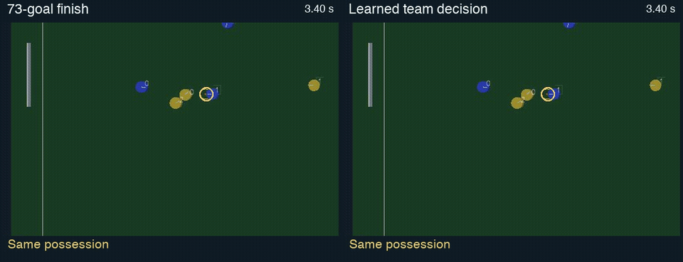

# Choosing the pass after a steal

On 40 new 90-second Webots starts, the distribution policy scored **248 clean-takeaway goals** and the 73-goal team scored **77**. Each side played a copy of itself on the same initial states. The 73-goal label comes from the previous team’s earlier test panel. [All 40 paired starts and head-to-head scores](comparison.json)

| Mirror matches | 73-goal team | New team |
| --- | ---: | ---: |
| Clean takeaways | 386 | 421 |
| Clean-takeaway goals | 77 | 248 |
| Conversion | 19.9% | 58.9% |
| Starts with a clean-takeaway goal | 35 | 38 |
| Pass attempts during clean takeaways | 0 | 114 |
| Completed passes | 0 | 62 |
| Clean goals with a completed pass | 0 | 56 |
| Goals from a verified moving lead pass | 0 | 56 |
| All open-play recovery goals | 91 | 272 |
| All scoreboard goals | 102 | 278 |

At clean recoveries the new team kept the incumbent finish on 1 possession, chose a carry on 258, and selected the first and second passing routes on 63 and 99 possessions respectively. A chosen pass can be abandoned if its lane closes before release. Verified moving lead-pass goals covered all six player combinations. The counts by passer and receiver were 0→1 (7), 0→2 (11), 1→0 (10), 1→2 (10), 2→0 (9), 2→1 (9).

The paired difference was +4.28 clean goals per match, with a 95% bootstrap interval of +3.33 to +5.20 across starts. The challenger scored more clean goals on 34 starts, tied on 2 and scored fewer on 4. In the final 45 seconds it scored 120 clean goals, including 25 with a completed pass. [Previous games and 100 Hz traces](control/) · [Challenger and mixed games](evaluation/)

In 16 head-to-head matches with the colors swapped on eight starts, the new team won 12, drew 2 and lost 2. The aggregate scoreboard was 48–15. The predeclared promotion gate required more fresh mirror clean goals, at least as many wins as losses head-to-head, and a verified moving lead-pass goal. **Passed the gate.** [Protocol](protocol.json)

## Watch the decision change

[](../../media/counterpass/same-possession.mp4)

The previous and new teams played separate self-play matches from the same kickoff. All 440 physical samples through the recovery agree. At 4.40 s Yellow 0 controls the ball. On the left the incumbent shoots and the ball goes out. On the right Yellow 0 leads Yellow 2. The receiver advances 0.27 m toward the planned intercept between release and arrival, with the nearest rival 0.39 m away at arrival, and scores at 6.40 s. Both 90-second films reproduced all 9,000 saved physical samples and every logged event. Neither showcased possession included a field-boundary excursion or robot center separation below 0.18 m. [Uncut challenger match](../../media/counterpass/open-play-match.mp4) · [Annotated pass](../../media/counterpass/open-play-recovery.gif) · [Replay checksums and selection](../../media/counterpass/same-possession.json)

## Training and physical scoring

The baseline attempted zero passes in 391 clean recoveries on its prior evaluation. Of its 161 opponent retouches, 124 followed a shot. Another 107 shots went out. Those prior games became training data for this release. The two earliest steals in the first 24 seconds of each previous kickoff supplied 77 recovery positions, including both successful and failed incumbent plays. The three new arms ran independently in native Webots from the original kickoff. Each branch shared the original physical trajectory through the steal. The four arms scored 12, 41, 35 and 23 times for the incumbent finish, carry, first passing route and second passing route respectively under the same follow-up horizon. Across 23 distinct training positions, a pass produced a goal after the incumbent failed. A passing arm may carry after 2.56 s without a safe release. The two passing arms scored 21 and 6 of their goals through completed passes. [Branch outcomes, features and prefix hashes](returns.json) · [Native training logs](training.json.gz)

The selector sees attack-relative field position, shot clearance, nearby pressure, ball speed and two passing routes. Each route has a lead target for a distinct teammate. The route planner considers clearance, the runner's space and shooting lane, distance, turn and run length. A ground pass uses the existing 2.2 m/s kicker and the finish uses its 4 m/s setting. Five validation folds kept all decisions from each kickoff together and tuned two selector families on 77 actionable positions. Six separate development starts compared the candidates in 60-second mirrors and both colors against the old team. Full matches selected the **shared ridge** policy. A branch earned one point for a verified goal before the next opposing touch or stoppage, and zero otherwise. [Selector fits](fit.json) · [Development scores](development.json) · [Development games](league.json.gz) · [Frozen checkpoint](policy.json)

To count a clean steal, the opponent and then the recovering player each need 0.20 seconds of sole roller control. A scoring pass must travel at least 0.55 m and give its intended recipient 0.20 seconds of sole control. A moving lead additionally requires the planned receiver position to be at least 0.10 m ahead along the run, release-time speed above 0.10 m/s along it, and at least 0.08 m of progress along it by first controlled arrival. The open-receiver count requires at least 0.35 m to the closest rival center at arrival. 29 fresh mirror goals met all these conditions. The simulation uses ground-truth state, ideal body velocities and a spring dribbler. In trained mirrors 0 matches flagged a boundary excursion, 10 flagged center separation below 0.18 m, and 2 clean goals overlapped either flag. Excluding flagged goals from both panels leaves 246 clean goals for the new team and 74 for the previous team. [Scoring and lead-pass audit](../../scripts/audit_counterpass.py) · [Frozen code and policy hashes](freeze.json)

## Reproduce

Run from the modern project with its Python environment and the pinned native Webots runtime. Training and qualification fixtures are disjoint. The evaluation command verifies the published checkpoint before launch.

```sh
python scripts/train_counterpass.py train runs/repeat-counterpass/train --workers 4
python scripts/fit_counterpass.py fit runs/repeat-counterpass/train --output runs/repeat-counterpass/weights
python scripts/train_counterpass.py dev runs/repeat-counterpass/dev --checkpoint runs/repeat-counterpass/weights/candidates.json --workers 4
python scripts/fit_counterpass.py freeze runs/repeat-counterpass/dev --output runs/repeat-counterpass/weights
python scripts/train_counterpass.py control runs/repeat-counterpass/control --workers 4
python scripts/train_counterpass.py evaluate runs/repeat-counterpass/evaluation --checkpoint runs/repeat-counterpass/weights/policy.json --workers 4
python scripts/audit_counterpass.py runs/repeat-counterpass/control runs/repeat-counterpass/evaluation runs/repeat-counterpass/comparison.json
python scripts/demo_counterpass.py find runs/repeat-counterpass/demo --control runs/repeat-counterpass/control --evaluation runs/repeat-counterpass/evaluation
python scripts/demo_counterpass.py previous runs/repeat-counterpass/demo
python scripts/demo_counterpass.py trained runs/repeat-counterpass/demo
python scripts/film_counterpass.py runs/repeat-counterpass/demo runs/repeat-counterpass/media
python scripts/record_open_play.py runs/repeat-counterpass/demo/trained runs/repeat-counterpass/media
```
