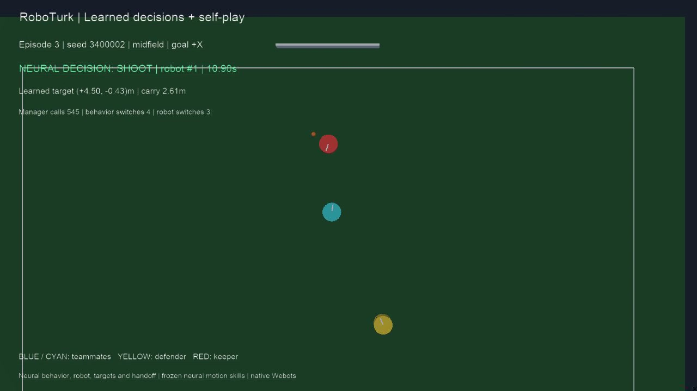

# Learned tactical decisions and self-play v2

The neural manager selects pass/receive, dribble or shoot, the acting robot,
receiving and dribble targets, receiving flank, goal corner, and when to retain or
update a receiving point. Its 75-input/12-output v4 contract runs throughout each
play. Frozen learned motion skills execute these decisions. Deployed inference has
no scripted target planner or stable-reception handoff; both opponents have planar
neural control throughout the episode.

All three reserved panels passed the unchanged predeclared qualification gates:

| Reserved panel | Goals | Defensive stops | Clean | Collisions | Unforced |
| --- | ---: | ---: | ---: | ---: | ---: |
| Final attackers / final defense | 107 | 126 | **233/240** | 2 | 5 |
| Final attackers / initial defense | 65 | 53 | **118/120** | 0 | 2 |
| Initial attackers / final defense | 60 | 57 | **117/120** | 1 | 2 |

Clean means a goal or legitimate defensive contact stop, not an attacking win.
The final pair scored 107/240 (44.58%) and completed 233/240 cleanly (97.08%). Its
failures were two robot collisions, four ball-outs and one loss after possession.
Defense made 41 interceptions and 85 keeper saves. All failures remain in the raw
records. Clean Wilson 95% interval: 94.10–98.58%; goal interval: 38.43–50.91%.
Gates use point estimates, not a claim that the lower confidence bound exceeds 95%.

The final panel exercised 80 actual passes, 35 stable receptions, 114 episodes with
at least 0.5 m controlled forward carry, 192 actual shots and 91 direct goals.
Midfield: 75/80 clean, 16 goals; advanced flank: 79/80 clean, 31 goals; close goal:
79/80 clean, 60 goals. Goal directions split 119 negative / 121 positive.
The manager and each opponent made 62,767 calls; the manager changed acting robots
in 37 episodes. Audits verify physical kick events, reception dwell, whole-ball
crossing inside posts, continuous inference, recorded neural target updates and
unchanged model/runtime hashes.

## Native demo

[Watch all nine consecutive games](../../media/learned-decisions-self-play-demo.mp4):
**9/9 clean**, five goals, two interceptions and two keeper saves; zero collisions
or unforced failures. Episode 3, starting **6.84 s**, shows a learned pass, reception,
robot/behavior handoff, dribble and scoring shot. The pass occurs at 8.22 s,
the receiver shoots at 17.52 s, and the goal occurs at 18.04 s. Other episodes show
direct shooting and successful defensive play.

All 1,140 native frames and original timing are retained: 45.6 s, 1280×720, 25 fps,
H.264. Each episode includes 0.6 s of terminal robot-HALT display, excluded from
scoring. Both native and delivery videos decoded fully; all nine terminal frames
and pass/reception/dribble/shot frames were inspected. Native MJPEG edge warnings
and small edge artifacts are recorded in [video provenance](demo-video.json) and
the retained encoder log. No case was rerun or selected for this demonstration.

## Training and selection

The candidate is the last completed generation of two alternating self-play
generations: **196,608 native Webots PPO steps, 192 accepted updates** across manager,
defender and keeper. Each role trained against retained historical opponents.
The lineage audit verifies every reset/pool selection, changed actors, frozen
motion actors and exact preservation of the manager's coordinate regressor.
Self-play updates behavior, robot, target-update, goal-corner and receiving-flank
readouts; learned continuous coordinate regression stays frozen.

Initialization included 750 native teacher/mixed-DAgger collection episodes,
176,011 manager observations and 780 supervised manager epochs, including contract
and label conversions. Keeper boundary and defender relative-speed coaching each
used 100 supervised epochs on native observations with derived labels. These are
training contributions, not runtime action overrides. The failed v1 league's
294,912 PPO steps and all three generations remain in
[decision_self_play_v1](../decision_self_play_v1/README.md). Its defensive ancestors
were retained and coached; its manager updates were replaced by the earlier manager
before the v4 refit. No isolated PPO improvement or monotonic strength gain is claimed.

| Development panel | Goals | Stops | Clean |
| --- | ---: | ---: | ---: |
| Factored-flank initialization, 60 games | 28 | 32 | 60/60 |
| Initialization, broader 120 games | 51 | 68 | 119/120 |
| Generation 1, 60 games | 30 | 29 | 59/60 |
| Generation 2, 60 games | 32 | 27 | 59/60 |
| Generation 2, broader 120 games | 47 | 70 | 117/120 |
| Generation 2, extended 240 games | 123 | 112 | 235/240 |
| All nine historical pairings, 270 games | 157 | 113 | 270/270 |

The broader final panel has two ball-outs and one collision; the extended panel
has three collisions, a robot field exit and a ball-out. All preparation failures,
checkpoints, raw outcomes and data provenance are retained. These development
results remain distinct from reserved qualification.

## Freeze and reproduction

Models and all 89 runtime files were frozen on November 19, 2026 at 19:28:57 Pacific
and published at [6906019](https://github.com/kadiru/metu-ros-pkg/commit/690601957abde5cd40980290288a4806c198db26)
before reserved cases. All 377 published files were independently matched to local
Git blob hashes. Reserved seeds: final 3300000–3300239; attack 3310000–3310119;
defense 3320000–3320119; fresh demo 3400000–3400008. No tuning followed qualification.

[Protocol, architecture and replay command](../../docs/LEARNED_DECISIONS.md) ·
[Training audit](training-audit.json) · [Freeze](freeze.json) ·
[Final panel](qualification/final-audit.json) · [Attack panel](qualification/attack-audit.json) ·
[Defense panel](qualification/defense-audit.json) · [Demo audit](demo-audit.json).
Portable final, bootstrap, attack and defense bundle JSON files resolve checkpoint
paths from the modern repository root.

Scope is an initial-possession two-attacker versus defender/keeper drill, three
starting families, both goal directions and blue IDs. It uses approximate
ground-truth Webots state, ideal body velocities, spring dribbling, fixed-speed
velocity kicks and contact-distance/modeled-mouth defensive stops. A stop does not
establish sustained defensive capture. Full matches, recovery/counterattacks,
official SSL rules, calibrated hardware and a complete live ROS/Webots graph remain
outside this qualification. Core tests and ROS builds are separate checks.
