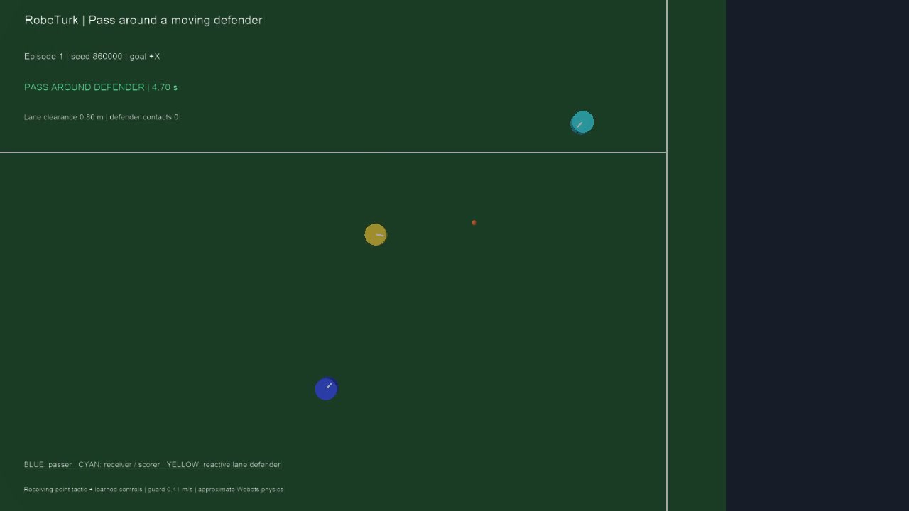

# Goal-conditioned defended passing and scoring

The frozen play scored **200/200 reserved Webots scenarios**, with **zero interceptions, possession losses or robot collisions**. Wilson 95% interval: **98.12–100%** for this scenario distribution. [Every episode](qualification.json) · [Derived summary](qualification-summary.json) · [Pre-test freeze](freeze.json).

Mean full sequence: **13.299 s**; ball displacement to stable reception: **2.8343 m**; receiver controlled carry: **3.2496 m**. The monitor checked **407,216 possession samples** and **531,960 defender physics samples** at 5 ms. Initial direct passes were blocked (maximum initial lane clearance 0.02475 m); minimum clearance at actual release was **0.7453 m**. Minimum ball-to-defender center distance was **0.4750 m**; minimum robot-to-defender center distance was **0.7042 m**. Every success contained exactly one passer kick and one receiver kick.

Negative/positive attacking direction: **99/99 and 101/101**. Passer robot ID0/ID1: **100/100 each**. Mean receiver lateral displacement: 2.4945 m; mean defender distance moved over a full sequence: 1.7707 m. Maximum whole-ball goal-crossing offset from goal center: 69.10 mm.

The checkpoints were frozen on November 19 at 02:51:49 Pacific, before seeds 850000–850199 were used once. No tuning followed qualification. The [native Webots demo](../../media/defended-pass-receive-score-demo.mp4) scored **6/6** on the preselected fresh seeds 860000–860005, with zero interceptions, losses or collisions. All outcomes are retained. The complete **84.12 s**, 1280×720, 25 fps H.264 recording decoded successfully; passing, carry and goal frames were inspected. It plays at normal simulation speed and includes 0.6 s outcome display per episode. [Demo records](demo.json) · [Video provenance and hash](demo-video.json).

## What is learned and what is scripted

A centralized, stateless 192×192 MLP controls both attackers during transfer. Its 62 inputs include the two robots, ball, defender, measured play memory, and a receiving-point target. Seven outputs control passer body vx/vy/omega/fire, receiver attack-frame vx/vy, and receiver omega. A coordinate rotation converts the receiver's translation into body commands. The network learns movement, stopping, pass timing and reception; no analytic attacker motion controller or teacher replaces its inference action.

The play **selects a receiving point analytically** once at reset: the receiver's initial x, on the opposite lateral side from its initial side of the defender, 2.2 m from the initial ball y, clipped to remain 0.65 m inside the touchline. The point is fixed for that play. The policy receives point error/range, ball and receiver field y, and receiver speed in addition to v2's 56 inputs. Target selection is not learned. This is a goal-conditioned hierarchical play, not an end-to-end learned tactic or decentralized multi-agent RL.

The actuator interface enables dribblers, uses a fixed 1.8 m/s pass and holds the passer after its actual kick. After 0.4 s of stable reception, `PassReceiveScorePlay` assigns the existing frozen learned scorer to the receiver, with a fixed 3.5 m/s shot. The state monitor and play independently track actual kicks and measured physics samples. There is no physics reset or teacher fallback at handoff. The opponent remains active through scoring.

## Experiment history

- The previous unobstructed learned passing policy scored **0/40** against the new defender. An initial analytic demonstration route scored 37/40; a wider route scored 40/40. These are separate baselines.
- [V1](../defended_pass_receive_v1/MODEL_CARD.md), with 52 inputs and body-frame translation outputs, received 23/60 after cloning and 38/60 after both DAgger and constrained PPO. It was never qualified.
- [V2](../defended_pass_receive_v2/README.md) changed receiver translation to the attack frame and added four velocity features. Transfer development: 59/60 refit, 58/60 DAgger, 59/60 PPO. Full development: 58/60. Its frozen qualification **failed at 185/200**: 11 interceptions, one transfer field exit, one transfer timeout, one invalid shot and one scoring-phase field exit. All outcomes remain published; its reserved demo was not run.
- V3 introduces the explicit receiving-point tactic and six goal/field/speed features. Its analytic-transfer/frozen-scorer baseline scored **40/40**. Fresh teacher collection: **300/300** receptions. Cloned neural policy: **59/60** transfer development, with one reception field exit. New mixed DAgger collection: **150/150** receptions. Refit: **60/60**; final constrained PPO: **60/60**. Full-play development scored **120/120**, with zero interceptions, possession losses or collisions, before freezing. Mean duration 13.2242 s; minimum release-lane clearance 0.8128 m.

V3 starts from the failed v2 PPO checkpoint, adding six zero-initialized input columns. Training seed 87, one CPU thread: 100 balanced cloning epochs, 150 DAgger episodes with 20% teacher/80% student action selection, 60 refit epochs, select the DAgger checkpoint, then 65,536 anchored PPO steps. Learning rate 3e−7; regression against training-observation actions with MSE ≤1e−6 and maximum normalized change ≤0.01; projection learning rate 3e−6. All 64 actor updates were accepted. **No incremental PPO success benefit is established over the 60/60 DAgger policy.** These are sequential experiments, not independent training-seed replications.

Training demonstrations: 800000–800299; DAgger: 820000–820149; transfer development: 810000–810059; broader full-play development: 810000–810119. Reserved qualification: 850000–850199; demo: 860000–860005. No qualification/demo observation enters training. Large training datasets remain in ignored `runs/defended-v3/demonstrations.npz`; stage checkpoints, collection results and development records are published here. [Reproduction](../../docs/DEFENDER_TRAINING.md).

Transfer SHA-256: `7e3cf3125d10a532716ca5b621f436ef22278541504bc28f99063d7c580f7d5c`.

Frozen scorer SHA-256: `6558b977dcdeb0001e9590b01ca1cfb9f3ec3fd16da1f43d17b8c3e6c9f6cc11`.

## Qualification scope

The passer starts holding a stationary ball. Attack-relative passer x is −2.0 to −1.2 m; y is ±0.55 m. The receiver begins 1.8–2.3 m forward, 0.30–0.55 m to either side. Headings span the full circle; roles and attack direction vary. The yellow defender starts 50–60% along the ball-to-receiver segment, blocking the initial straight pass.

The fixed analytic `reactive_lane_defender_v1` guards its initial longitudinal line, patrols the original passing lane by ±0.07 m with randomized period 2–4 s/phase, and tracks the predicted crossing of an incoming ball. Speed varies from 0.25–0.55 m/s; it faces the ball with its dribbler on. It is not a free-ranging adversary, goalkeeper or learned self-play opponent.

A success requires stable possession before a real pass, at least 1 m transfer displacement, 0.4 s stable reception with relative speed below 0.2 m/s, at least 0.5 m retained progress toward goal, and an actual receiver kick from at most 1.8 m. The whole ball must cross inside the goal posts. Interceptions, robot collisions, invalid kicks, pre-kick possession losses, field exits and timeouts fail. Transfer timeout: 20 s; scoring: 24 s. Defender contacts/proximity and possession are checked every 5 ms. Predeclared acceptance: at least 95% of 200 full plays, zero collision and pre-kick possession-loss episodes.

Native Webots R2025a nightly 17/11/2026, commit `e5d1122a3cd59f007ee4b37c8f651b50e7ee83d2`; ground-truth state, ideal body velocity, ODE contacts, spring/damper dribbler and edge-triggered velocity kicks. This does not qualify calibrated hardware, noisy perception, radio latency, faster/free-ranging defenders, goalkeepers, moving-target passes, variable kick power or full SSL matches. The Supervisor uses the core play API directly; the ROS graph still needs applied-kick feedback and complete live integration validation.
