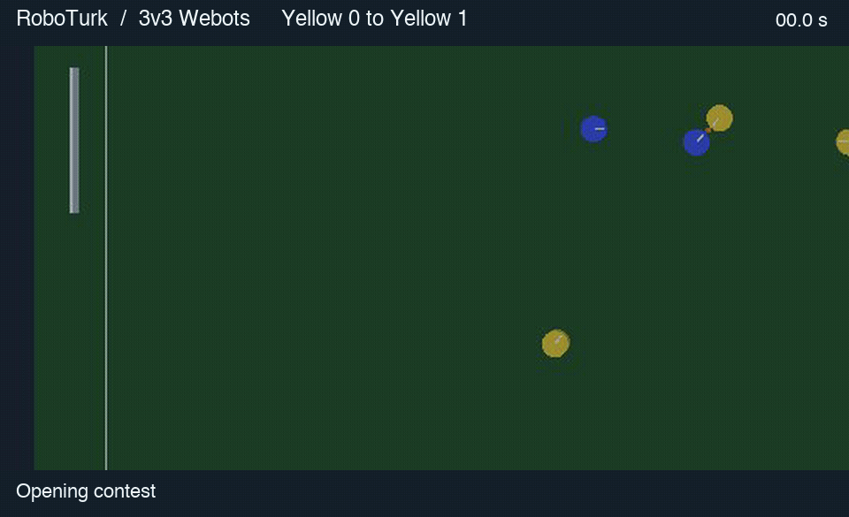

# Leading a moving teammate around a blocked lane

The frozen 3v3 teams scored **31/40** after leading an open teammate around a blocked dribble lane. Opening interceptions fell from nine in the preceding release to **1**. On these same fresh starts the previous team scored from 27 direct-to-receiver passes and had 7 interceptions. The target was at least 24 goals and at most eight interceptions. All 40 opening contests count. Each team played the other side of the same frozen policy.

[](../../media/lead-outlet/lead-pass.mp4)

Yellow 0 leads Yellow 1 by 0.25 m. The receiver runs 0.21 m along that heading before controlling the pass. Yellow 1 scores at 4.27 s. The ring appears at kick time and marks the recorded intended point. The full 54-second native recording includes all three fresh demo openings (2/3 qualifying). A second Webots launch reproduced all 5,400 states, passing targets and events. [Uncut recording](../../media/lead-outlet/lead-pass.mp4) · [Full GIF](../../media/lead-outlet/all-openings.gif) · [Frame and trace provenance](../../media/lead-outlet/recording.json)

## What happened to the nine earlier passes

In eight cases a defender touched the ball within 0.11–0.19 s of the kick. The ball had traveled only 0.22–0.35 m. Each passing corridor was open at selection and had less than 0.17 m of center clearance at release. In the ninth the lane stayed open, and the defender reached the ball near the receiver after 1.56 s. These are first unintended mouth contacts reconstructed from 100 Hz physical samples. Clearance is measured from opponent centers and capped at 2 m.

| Prior seed | Lane at decision (m) | Lane at kick (m) | Time to interception (s) | Ball travel (m) |
| ---: | ---: | ---: | ---: | ---: |
| 12300006 | 1.05 | 0.17 | 0.13 | 0.25 |
| 12300008 | 2.00 | 0.08 | 0.14 | 0.26 |
| 12300010 | 0.29 | 0.03 | 0.19 | 0.35 |
| 12300011 | 1.08 | 0.13 | 0.11 | 0.22 |
| 12300017 | 2.00 | 0.07 | 0.17 | 0.31 |
| 12300018 | 1.08 | 0.06 | 0.18 | 0.33 |
| 12300020 | 1.02 | 0.99 | 1.56 | 0.51 |
| 12300026 | 2.00 | 0.05 | 0.18 | 0.33 |
| 12300029 | 1.01 | 0.07 | 0.17 | 0.31 |

Replaying those exact nine starts with the new team produced **8 lead-pass goals and 0 interceptions**. They form a diagnostic replay outside the fresh 40. In the synchronized comparison both recordings matched their original states, actions and events. [Side-by-side GIF](../../media/lead-outlet/matched-lead.gif) · [Matched video](../../media/lead-outlet/matched-lead.mp4) · [Original nine measurements](previous-interceptions.json) · [All nine reruns](historical-1/audit.json)

## Fresh qualification

| Opening outcome | Count |
| --- | ---: |
| Pass goal | 31 |
| No confirmed recovery | 1 |
| No opening pass | 3 |
| Opponent retouch before pass | 2 |
| Intercepted | 1 |
| No uninterrupted finish | 2 |

The new team released 34 trace-matched opening passes across the 40 contests. The previous team released 35. Among the qualifying goals, the median release target was 0.32 m ahead along measured receiver velocity. The receiver moved a median of 0.27 m along that direction by first sustained contact. The median distance between the ball at reception and the target logged before the kick was 0.06 m. The new team's 72,000 physical samples recorded 0 robot-center separations below 0.18 m and 0 robot field exits. Both panels used one new Webots process per start and matched all 40 opening frames exactly. [Paired results](comparison-1.json) · [New policy traces](qualification-1/) · [Previous policy traces](baseline-1/)

The original blocked-lane audit still requires a verified contested recovery, a blocked dribble corridor, an open receiver, at least 0.55 m of pass travel, 0.20 s of exclusive reception and a goal in the same possession. The new test additionally requires receiver speed of at least 0.12 m/s at kick time, a target at least 0.15 m ahead along the measured run, at least 0.12 m of receiver progress during flight, and contact within 0.32 m of the intended point. A goal missing any of these conditions earns no lead-pass credit. The interception count also includes opening passes that miss the lead or openness conditions. [Registered protocol](protocol.json) · [Source and model freeze](freeze-1.json)

## Policy and self-play

The passer evaluates both teammates and candidate run directions. It predicts the rolling ball’s arrival and the distance a defender can cover before that arrival. The receiver times its run to the passer’s turn. At release the team records the intended mouth position and steers the receiver to where the measured flight crosses that point. The teams retain their existing contested recovery, defenders, finishing controller, field geometry and contact physics. The approach uses centralized simulator state and explicit motor rules with team and passing parameters selected by native self-play returns.

Four leagues ran 456 training games. The initial development policy converted 3/14 and had eight interceptions. The synchronized incumbent converted 19/24 in separate development games with zero interceptions. The final population included the two leading policies and three children bred from native returns. Every candidate played both sides on the same 32 training layouts. Selection rewarded verified lead-pass goals and penalized intercepted openings. Candidate 3 was frozen before the new qualification and control panels. [All populations and training games](training/) · [Selection](selection-1.json) · [Checkpoint](policy-1.json)

The reported rate applies to randomized, symmetric 3v3 blocked-lane midfield openings under simplified Webots physics and ground-truth perception.

## Reproduce

From the RoboTurk ROS 2 directory, use the project environment with NumPy and PyTorch. The launch receipts identify the native Webots binary by SHA-256. FFmpeg and Pillow are required for GIF encoding.

```sh
python scripts/train_lead_outlet.py qualify runs/lead-qualification --version 1 --webots /path/to/webots
python scripts/train_lead_outlet.py baseline runs/lead-control --version 1 --webots /path/to/webots
python scripts/compare_lead_openings.py runs/lead-qualification runs/lead-control runs/lead-qualification/comparison.json
python scripts/train_lead_outlet.py demo runs/lead-demo --version 1 --webots /path/to/webots
python scripts/record_blocked_outlet.py runs/lead-demo runs/lead-media
```
