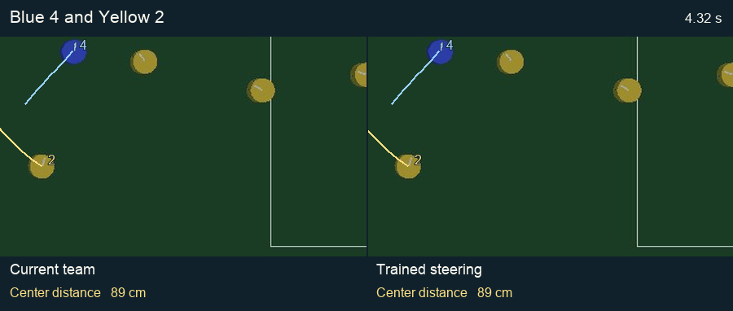

# Avoiding two open-play collisions in 5v5

The two incidents came from the same uncut Webots game. Blue 2 and Yellow 3 converged near midfield, and later Blue 4 crossed Yellow 2's path. TIGERs AutoRef reported a 1.54 m/s crash in the first encounter and a 1.61 m/s crash in the second. [Original film and official Game Controller calls](../../media/placement-traffic/open-match.json)

[](../../media/open-motion/two-encounters.mp4)

### Results on fresh starts

| Across 16 paired one-minute games | Current team | Trained team |
| --- | ---: | ---: |
| TIGERs crash calls | 47 | 0 |
| Completed passes | 151 | 201 |
| Pass attempts | 256 | 337 |
| Completion rate | 59.0% | 59.6% |
| Goals | 21 | 21 |

The trained team had fewer crashes on 14 starts. Both teams were clear on the other two. The 50 extra completions came with 81 extra attempts. The trained team scored more goals on seven starts, fewer on six, and the same number on three. In the separate four-game development panel the result was seven crash calls versus zero, 12 completed passes each and two goals versus zero. The development games are excluded from the fresh totals. [All fresh pairs](fresh.json) · [Paired summary](paired-summary.json) · [Development pairs](development.json)

The first reserved match is available uncut. Blue 4's pass reaches Blue 3 before Blue scores at 40.32 s. The trained teams complete 13 passes with zero crash calls in that game. A separate headless run of each arm reproduces all 1,500 measured states, roles and events exactly. [Watch the full minute](../../media/open-motion/fresh-match.mp4) · [Watch the scoring sequence](../../media/open-motion/first-goal.gif) · [Replay verification](replay.json)

### What the players can see

The released 5v5 controller jointly limited both teams' requested velocities. Its replacement takes one team's requested motion and estimates surrounding players' velocities from their last two overhead positions, 40 ms apart. It uses zero observed velocity on the first sample of a kickoff. When a straight run predicts a close approach, the player evaluates turns and speed reductions, including stopping. It preserves the role planner's rotation, roller and kick requests. Both simulated teams use the same learned steering weights and retain their existing passing and shooting policies. The experiment uses ideal overhead positions and Webots body velocity actuation. [Steering implementation](../../src/roboturk_core/roboturk/open_motion.py) · [Observation contract test](../../tests/test_open_motion.py)

### How the policy was fitted

Three generations of reward-based parameter search evaluated four candidates per generation. Each played the two incident branches and one 24-second game against a copy of itself in native Webots. Search rewarded clearance in the two incidents, completed passes and goals, and penalized fast close approaches. The top two candidates determined the next search mean. The last generation's winner uses a **0.486 s horizon**, **0.305 m desired center clearance** and **0.663 rad steering increment**. The 36 training rollouts ended before the official development and fresh comparisons. The actor was frozen at commit `6b49c79`. [Every training rollout and reward](training.json) · [Frozen weights](actor.json) · [Registered seeds and outcomes](protocol.json)

### What happened at the two original encounters

Each test started from the original kickoff and ran the released policy up to its own switch point. Every sampled ball and robot state up through the switch matched the archived match exactly. The baseline also reproduced the entire archived trajectory in both windows. In the second replay the earlier crash therefore remains visible to the detector in both arms.

| Target encounter | Switch time | Closest centers, current | Closest centers, trained | Crash calls after switch, current / trained |
| --- | ---: | ---: | ---: | ---: |
| Blue 2 and Yellow 3 | 0.32 s | 19.5 cm | 34.3 cm | 1 / 0 |
| Blue 4 and Yellow 2 | 4.64 s | 19.5 cm | 31.8 cm | 1 / 0 |

The two GIFs show each approach at half speed. The paired film plays at match speed and briefly holds the final frame between encounters. [First encounter GIF](../../media/open-motion/encounter-1.gif) · [Second encounter GIF](../../media/open-motion/encounter-2.gif) · [Measured clearances and replay checks](../../media/open-motion/incidents.json)

A separate eight-second replay used the official SSL Game Controller v3.23.1 and TIGERs in active mode. Starting both clocks on the first FORCE_START heartbeat, the Game Controller accepted both original crashes with the current policy. It recorded zero crashes with trained steering active from kickoff. In an initial unsynchronized run the candidate spent its first 40 ms awaiting the broadcast. The archive retains both runs. [Active game reports and kickoff specifications](active-game.json)

### How the matches were scored

Each arm played the same 16 fresh one-minute starts, with four starts for each combination of kick-off team and field direction. Blue and Yellow both ran the current controller in the baseline arm and both ran trained steering in the candidate arm. Scores are combined across both colors. A passive TIGERs AutoRef 1.7.1 processed the 25 Hz Webots camera samples from each uninterrupted segment using its own tracker. Each practice kickoff started a new detector so formation resets could not produce artificial crashes. The local referee restarted on whole-ball goals and outs. Play continued after detector calls, giving the teams the same playing time. This panel tests open play in Webots.

A completed pass requires an actual kick and three consecutive samples of exclusive roller contact by the intended teammate within two seconds. The ball must travel at least 55 cm. A new kick, another player's confirmed possession or a formation reset ends the opportunity. Goal credit requires the entire ball to cross the goal line inside the mouth on a native physics substep. Both types of TIGERs crash reports are counted. The archive includes all 48,000 fresh frames, all development and incident frames, passes, crossing positions and original detector event payloads. [Evidence archive](match-evidence.zip) · [Metric definitions](../../scripts/autoref/open_motion_metrics.py)

### Reproduce

From the modern stack directory, activate the project environment and use a new output directory for each run. The evaluation launcher accepts paths to the TIGERs distribution, compiled event observer and Java runtime. The native launcher uses Webots on PATH or the project runtime. The ordinary match launcher accepts the trained policy in either local practice or official-referee mode. [Runtime setup](../../media/autoref/README.md)

```sh
python scripts/run_five_roles.py runs/observed-demo --seconds 60 --seed 27300000 --watch --open-play-policy policies/open_motion_v1/actor.json
python scripts/autoref/train_open_motion.py runs/observed-fit
python scripts/autoref/evaluate_open_motion.py incidents runs/observed-incidents
python scripts/autoref/evaluate_open_motion.py fresh runs/observed-fresh
python scripts/autoref/verify_open_motion.py runs/observed-fresh
python scripts/autoref/film_open_motion.py incidents runs/observed-incidents runs/observed-video
python scripts/autoref/film_open_motion.py fresh runs/observed-fresh runs/observed-video
```

To recheck the published results locally, extract the evidence archive and run the verifier on its `fresh` directory.
