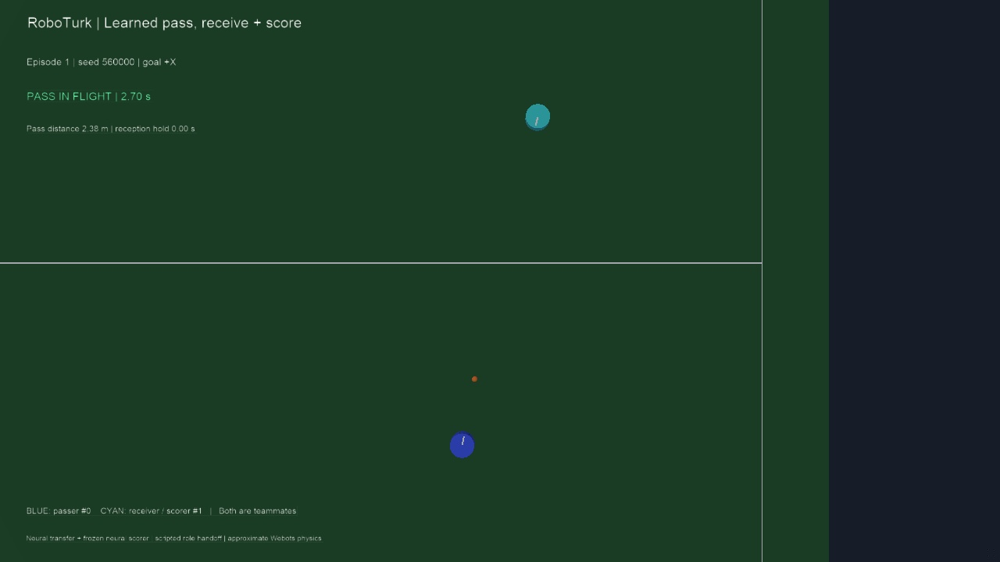

# Learned two-robot pass, receive and score v2

Qualified November 18, 2026 (America/Los_Angeles). A centralized learned transfer policy coordinates two teammates. After a real pass and 0.4 s of stable reception, a scripted play switches the receiver to the existing learned scoring policy. There is no physical reset or ball teleportation at the handoff. Both networks command motion and kick timing; there is no analytic motion or teacher fallback in the learned play.

| Reserved full-sequence qualification | Result |
| --- | --- |
| Pass → stable reception → retained carry → kick → goal | **200/200**, seeds 550000–550199 |
| Premature passes/shots; robot collisions | **0; 0** |
| Possession losses before either valid release | **0/200** |
| Physics possession checks | **399,816**, every 5 ms |
| Negative / positive attacking goal | **95/95 / 105/105** |
| Passer robot ID 0 / ID 1 | **87/87 / 113/113** |
| Mean complete-sequence duration | **12.3278 s** |
| Mean ball displacement from pass to stable reception | **1.9138 m** |
| Mean pass-launch distance to teammate | **1.9193 m** |
| Mean receiver's controlled progress toward goal | **2.7488 m** |
| Mean shot distance | **1.2860 m** |
| Fresh preselected demo (560000–560005) | **6/6 full-sequence goals** |
| Wilson 95% success interval | **98.12–100%**, for this scenario distribution |

Every success had exactly one actual passer kick and one actual receiver kick. Minimum received ball displacement was 1.249 m; maximum goal-line crossing offset from goal center was 76.41 mm. Both checkpoints were frozen before the reserved set, and no tuning followed. The [freeze record](freeze.json) contains the hashes, acceptance target and timestamp. The predeclared target was≥95% full-sequence success and zero pre-kick possession losses or robot collisions on200 reserved scenarios.

The **77.64-second native Webots recording** shows all six consecutive fresh scenarios at normal simulation speed. Blue identifies the passer and cyan the receiver/scorer; both are teammates. Every outcome is retained in [demo.json](demo.json). Episode durations:10.78,12.92,10.40,12.12,13.66,14.16 s, plus 0.6 s outcome display each. Camera recording was checked separately on an already-used development seed; the six demo seeds were not previewed or selected by outcome.

## Task and scope

The passer starts with a stationary ball at its mouth. Attack-relative passer x is−2.0 to−0.7 m and y±1.1 m; the receiver starts1.3–2.4 m forward and±0.9 m laterally. Both initial headings span the full circle. Robot IDs and attack direction are randomized. Two teammates, unguarded goal, no obstacles/opponents, ground-truth state.

Before passing, require 0.4 s stable possession. A pass must apply an actual kick with launch-to-teammate distance≥1 m. Reception must be by the designated teammate after≥1 m ball displacement and 0.4 s continuous mouth control with relative speed<0.2 m/s. The receiver must then carry≥0.5 m closer to goal under continuous possession and kick from≤1.8 m. The whole ball must cross the opponent's goal line inside the posts. Invalid kicks, short transfers, possession loss, robot collisions, field exits and timeouts cannot count as goals. Timeouts:16 s transfer plus 24 s scoring. Physics checks run every 5 ms.

## What is learned and what is scripted

The transfer actor is one stateless 192×192 MLP with 36 inputs and seven outputs: passer vx/vy/omega/fire intent, receiver vx/vy/omega. Inputs include both robots' body-relative ball states, teammate geometry, signed aiming errors and measured play memory. The contract is `roboturk.pass_receive.v2`; old34-input v1 checkpoints remain loadable. This is centralized coordination, not decentralized multi-agent RL.

Skill semantics keep the passer dribbler enabled until firing, request a fixed 1.8 m/s pass, hold the passer after its applied kick, and enable the receiver dribbler while receiving. The receiver cannot shoot during the receiving role. The scripted play detects0.4 s stable reception and assigns the frozen17-input capture/dribble/shoot v2 policy to that robot; its fixed kick request is3.5 m/s. Independent dribbler duty, kick power and the role-handoff decision are not learned. Early fire intents before the valid pass are evaluated as failures, not silently blocked.

## Training history

[Original v1 experiment](../pass_receive_v1/README.md):300 actual Webots demonstrations,80 cloning epochs,150 DAgger episodes,50 refit epochs,65,536 constrained PPO steps, seed 47. Transfer development results54/60 after cloning,37/60 after DAgger,56/60 after PPO; failures were release timeouts, with no possession losses. All 64 v1 actor updates were rejected, so those evaluation differences do not establish a PPO actor benefit. No v1 qualification was run. All three checkpoints and complete per-episode records are retained.

V2 adds explicit signed aiming errors and starts from v1's cloned checkpoint. It reuses only v1 training observations, refits 80 epochs, collects 150 new DAgger episodes520000–520149, and refits 50 epochs. The mixed teacher/student collection had148/150 receptions, with two premature-pass failures retained in dagger-collection.json. No development, qualification or demo observations are added to training. New transfer development seeds 510000–510059:

| Stage | Receptions | Possession losses | Mean transfer time |
| --- | ---: | ---: | ---: |
| Angle refit | 60/60 | 0 | 5.0400 s |
| DAgger | 60/60 | 0 | 4.9497 s |
| Final constrained PPO | 60/60 | 0 | 4.9453 s |

The DAgger checkpoint was selected on development, followed by 65,536 PPO steps, seed 57,one CPU thread, lr3e−7, training-observation reference regression and actor probe bounds (MSE1e−6,max normalized change0.01). Projection lr3e−6; all 64 actor updates were accepted. DAgger already passed all development scenarios: **no incremental PPO success benefit or learning-from-scratch claim is made**. These sequential experiments are not independent training-seed replications. Full learned-play development scored 60/60, mean12.265 s, before the separate reserved qualification.

## Artifacts and reproduction

- [Transfer checkpoint](policy.zip) and required [manifest](policy.json). SHA-256: `317bbf99ac4e436ef43d4bb1140e1e328749d5fdb01930a572ab0ad9f2d157f3`.
- Required frozen [scoring checkpoint](../capture_dribble_shoot_v2/policy.zip), SHA-256: `6558b977dcdeb0001e9590b01ca1cfb9f3ec3fd16da1f43d17b8c3e6c9f6cc11`.
- [Every qualification outcome](qualification.json), [summary](qualification-summary.json), [full-play development](full-development.json), [transfer development](development.json), [angle-refit results](bc-development.json), [DAgger results](dagger-development.json), [collection failures](dagger-collection.json), [actor updates](anchor-updates.json), [stage manifests/hashes](experiments.json).
- [Training commands and scenario definition](../../docs/TEAM_TRAINING.md). Original datasets remain local in ignored runs/team-v1 and runs/team-v2; regenerate via the documented historical revision.
- Source: local9e18086, [published04a6ee14](https://github.com/kadiru/metu-ros-pkg/commit/04a6ee147ab3ba1f136e97a1f6981d058b154d21). [Runtime provenance](../../docs/runtime-manifest.json) and [Python dependencies](../../requirements-macos-validation.txt).

Load `TeamCheckpoint` plus the existing `CheckpointPolicy(..., Skill.SHOOT, Config())` into `PassReceiveScorePlay`. Assign distinct teammate roles with reset; call commands for each control frame and observe with measured physics samples and actual kick feedback. Full evaluation and demo invoke this play directly; its memory is checked against an independent task monitor. Referee stops/missing perception hold both robots. The current ROS message graph does not yet supply actual kick feedback, so this is direct Supervisor evidence, not a complete live ROS/Webots game run.

Webots R2025a nightly17/11/2026 uses ideal body velocity, ODE contacts, a bounded spring/damper dribbler and edge-triggered ball-velocity kicks. No calibrated wheels/rollers/kicker, opponents/goalkeepers, vision noise, radio latency, full SSL rules or hardware transfer. Arbitrary initial acquisition by the pair, passes to running teammates and team-match strategy remain unqualified.
