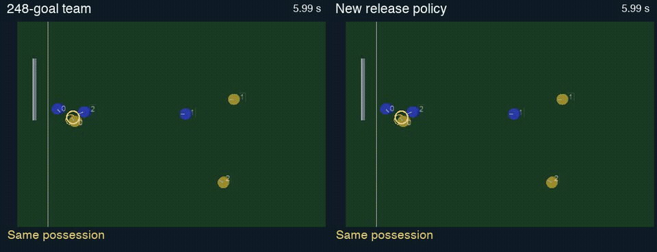
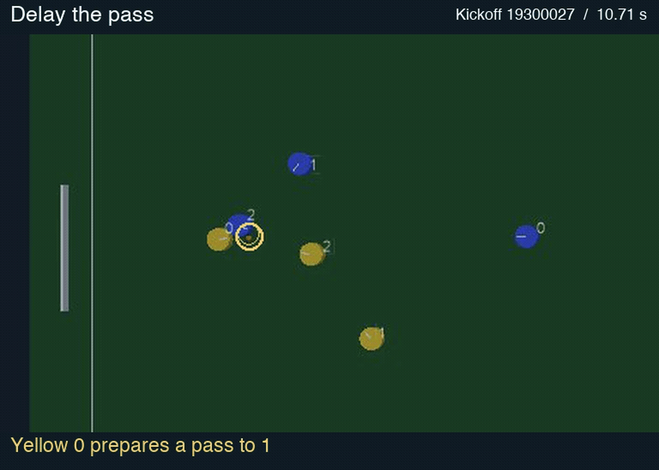

# Reconsidering the pass at the kick

On 40 fresh 90-second native Webots starts, the challenger scored **222 goals from clean steals** against **230 for the previous team**. The 248-goal name refers to its earlier panel. Each team played a copy of itself, starting from identical kickoffs. Both colors count. The challenger passed the interception, completed-pass and head-to-head checks. It fell 8 clean-steal goals short of the scoring check, so the 248-goal team remains the qualified team.

| Matched mirror games | 248-goal team | Release policy |
| --- | ---: | ---: |
| Goals / clean steals | 230 / 386 | 222 / 359 |
| Conversion | 59.6% | 61.8% |
| Starts with a clean-steal goal | 38 | 38 |
| Attempted passes after clean steals | 108 | 67 |
| Verified completions | 71 | 60 |
| Interceptions | 30 | 7 |
| Interceptions per attempted pass | 27.8% | 10.4% |
| Clean goals following a completed pass | 60 | 54 |

The change in interception rate was -17.3 percentage points. Its paired kickoff bootstrap 95% interval was -28.9 to -6.3 points. The clean-goal difference averaged -0.20 per game (95% interval -0.75 to +0.33). Head-to-head, the challenger won 11, drew 0 and lost 5 in 16 games across eight starts with colors swapped. Its aggregate score was 61–38. [Protocol](protocol.json) · [All paired results and individual release decisions](comparison.json) · [Previous matches](control/) · [New and head-to-head matches](evaluation/)

## Watch a release decision

[](../../media/pass-release/same-possession.mp4)

The two panels show an archived interception and a native replay that changes only that release choice. All 684 physical samples before the release agree. At 6.84 s, Blue 2 switches from receiver 1 to 0. The previous pass is intercepted. The new sequence ends in a goal at 11.28 s. Both recordings were reproduced against the source events and full 100 Hz trajectories. [Full fresh match](../../media/pass-release/open-play-match.mp4) · [Fresh scoring possession](../../media/pass-release/open-play-recovery.gif) · [Replay evidence](../../media/pass-release/same-possession.json)

## What happened on the 43 archived interceptions

Only 3 of the 43 intended receivers even reached roller-contact geometry before interception. 26 intended passes were shorter than 1 m. Eight were longer than 2 m, against one of the 62 completed passes. The release review evaluates both short passes near the receiver and longer flights through a closing lane. Release-time inputs cover receiver offset and motion, target space, rival arrival along the flight and the alternative teammate's route. [All 114 archived attempts, with geometry](interceptions.json)

The new policy acts only when the 248-goal team would already kick a pass after a clean steal. Its teammate-selection, dribbling, shooting and defending policies otherwise use that checkpoint. Each training possession supplies four returns on the same observed state. The original native run supplies immediate release. Three Webots replays try delaying the pass at least 0.32 s while updating the same runner's target, switching to the other teammate, and carrying toward a shot. A switch or delay can still turn into a carry if the passing window closes. The branch horizon is 12 s, rounded up to the next simulation second and capped by regulation time. Each receipt records the verified identical physical prefix. Training used 53 opportunities and 159 new branches, including 24 interceptions, 24 completions and five other outcomes. [Native returns and observations](returns.json) · [Training games](training.json.gz)

Kickoff-grouped five-fold validation fitted trees with different values for goals, completed passes and interceptions and a local action-value model. Six separate development kickoffs tested the candidates in self-play and against the 248-goal team. Selection gave priority to policies that learned all four choices and met the development checks. The selected family was **local advantages**. The checkpoint was frozen before opening the fresh panel. [Fits](fit.json) · [Development league](development.json) · [Checkpoint](policy.json) · [Source and policy hashes](freeze.json)

The selected policy also replayed each archived interception against its original opponent, intervening only at that release. Of 43, 38 avoided another interception, 6 became a completed pass and 19 led to a goal. Avoiding an interception includes decisions to carry and plays that ended without a goal. Of the 19 archived interceptions outside branch fitting, 8 became goals. These diagnostic replays share the prior season's kickoff pool. The fresh panel above measures generalization. [All 43 matched replays](historical.json) · [Native historical games](historical-games.json.gz)

## What the learned policy actually did

[](../../media/pass-release/release-choices.mp4)

The reel shows three scoring possessions. Yellow 0 waits 0.32 s before finding the original receiver on kickoff 19300027. On kickoff 19300004 the team switches to the other teammate on one steal and chooses to carry on another. The on-screen kickoff IDs and clocks identify the plays in the saved matches. [Reel events and replay checksums](../../media/pass-release/release-choices.json)

| Choice at a ready kick in fresh mirrors | Decisions | Later completed pass in the same chain | Goals in the same chain |
| --- | ---: | ---: | ---: |
| Release | 52 | 49 | 43 |
| Delay | 7 | 1 | 6 |
| Switch | 13 | 10 | 10 |
| Dribble | 36 | 0 | 19 |

Of the delays, 2 went on to kick to the original receiver at least 0.32 s later. Of the switches, 13 kicked to the alternative teammate. The rest of those choices could end in a fallback carry, a loss or a stoppage before the planned kick.

The clean-takeaway audit requires sole roller control by the opponent and then the recovering robot for 0.20 s each. A completed pass requires at least 0.55 m of physical ball travel and 0.20 s of exclusive control by the intended recipient. The simulator supplies ground-truth state, idealized body velocity and a spring dribbler. 0 new mirror games had a robot boundary excursion and 2 had centers closer than 0.18 m. 2 new clean goals and 1 previous clean goals overlapped a geometry flag. [Physical audit](../../scripts/audit_pass_release.py)

## Reproduce

Use the project's native Webots runtime and Python environment. Keep generated runs and retrained weights in a separate directory.

```sh
python scripts/train_pass_release.py audit runs/archive-pass-audit.json
python scripts/train_pass_release.py train runs/repeat-release/train --workers 4
python scripts/fit_pass_release.py fit runs/repeat-release/train --output runs/repeat-release/weights
python scripts/train_pass_release.py dev-control runs/repeat-release/dev-control --workers 4
python scripts/train_pass_release.py dev runs/repeat-release/dev --checkpoint runs/repeat-release/weights/candidates.json --workers 4
python scripts/fit_pass_release.py freeze runs/repeat-release/dev --output runs/repeat-release/weights
python scripts/train_pass_release.py historical runs/repeat-release/historical --checkpoint runs/repeat-release/weights/policy.json
python scripts/train_pass_release.py control runs/repeat-release/control
python scripts/train_pass_release.py evaluate runs/repeat-release/evaluation --checkpoint runs/repeat-release/weights/policy.json
python scripts/audit_pass_release.py runs/repeat-release/evaluation runs/repeat-release/comparison.json --control runs/repeat-release/control
python scripts/demo_pass_release.py find runs/repeat-release/demo --control runs/repeat-release/control --new runs/repeat-release/evaluation --historical runs/repeat-release/historical
python scripts/demo_pass_release.py previous runs/repeat-release/demo
python scripts/demo_pass_release.py trained runs/repeat-release/demo
python scripts/demo_pass_release.py full runs/repeat-release/demo
python scripts/demo_pass_release.py extras runs/repeat-release/demo
python scripts/film_counterpass.py runs/repeat-release/demo runs/repeat-release/media
python scripts/record_open_play.py runs/repeat-release/demo/full runs/repeat-release/media
python scripts/film_release_choices.py runs/repeat-release/demo runs/repeat-release/media
```
