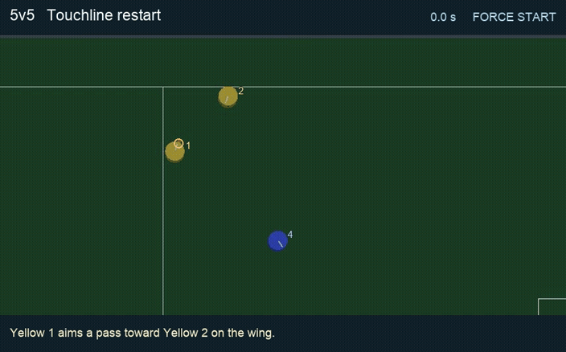

# 5v5 touchline ball placement

The official SSL Game Controller accepted **40 of 40** fresh placements in Webots, 20 for Blue and 20 for Yellow. TIGERs AutoRef 1.7.1 issued **zero placement-interference reports**. The ball finished a mean **1.83 cm** from the designated point, with a maximum error of **2.53 cm**. The controller confirmed success after 11.83 simulation seconds on average and 14.20 s at most. The registered threshold was 38/40 within 30 s, with zero interference. [Protocol](protocol.json) · [Per-start results and official event IDs](qualification.json) · [Summary](summary.json)

[](../../media/placement/touchline-restart.mp4)

## What was learned

The awarded team assigns its nearest field player to retrieve the ball and a second player to an outlet. The placer reuses the 5v5 chase and spring-dribbler controls. A five-parameter policy sets approach speed, carry speed, braking gain, release distance and release speed. Three generations of reward-based search evaluated six candidates on three shared Webots starts per generation, 54 physical rollouts across nine training starts. The top two candidates shaped the next sampling distribution. Reward included placement success, time and final error. Player selection, the outlet, the release-and-retreat state machine, corridor clearance and the free-kick routine are programmed. [Trained parameters](actor.json) · [Every candidate and rollout](training.json) · [Placement play](../../src/roboturk_core/roboturk/placement.py)

The initial faster release failed all four smoke tests. Slowing release and choosing a retreat that stays on the playing surface allowed the candidates to settle the ball. All 54 candidate rollouts met the local criterion, including the corrected initial candidate. The search ranked successful candidates by speed and accuracy. The selected actor passed 12/12 independent development starts, followed by four official development awards. These development samples are separate from the 40-start result. [Initial failures](initial-smoke.json) · [Development measurements](development.json) · [Official development events](controller-development.json)

## What the officials saw

For each fresh start the table set the award and designated point in the real Game Controller v3.23.1. The ten robots acted on its UDP broadcast. The test varied the touchline, ball position and initial velocity, designated point, player headings and jersey assignments. An opponent started inside the placement corridor. Webots sent measured ball and robot positions through the TIGERs vision filter. Each credited placement has a detector report, a unique accepted event in the Game Controller state store, the matching broadcast event ID, and a stationary ball at the end of the robot's retreat. The 40-game panel produced 40 detector reports, all for successful placement. [Controller history](qualification-controller.jsonl.gz) · [Original detector protobufs](qualification-tigers.txt)

The team also replayed the four previously observed touchline crossings with their archived robot poses and ball velocities. Robot velocities start at zero. The live official fixture allows 1.4 s for the tracker to observe the reset before issuing the placement command. All four were accepted with zero interference. The fastest took 11.72 s and the slowest took 29.84 s. In an earlier reconstruction the fast diagonal ball rolled beyond the end of the simulated floor. The final field has outer boards on all four sides. [Historical measurements, including the failure](development.json) · [Four official restarts](controller-archived.json) · [Historical controller log](archived-controller.jsonl.gz)

The separate film begins with a scripted overhit pass. Yellow 1 sends it over the touchline. TIGERs detects the exit and the controller awards Blue the restart. Blue 4 retrieves, carries, releases and withdraws. The ball rests 2.04 cm from the target. Blue 4 then takes the awarded direct free kick and Blue 3 controls the ball 1.50 m from the kick. The ground-truth monitor requires five consecutive 40 ms control samples at the receiver and a ball speed below 0.35 m/s. It found zero intervening third-player possession samples. Physics runs continuously from the opening pass through reception. The GIF plays at double speed. [Normal-speed Webots film](../../media/placement/touchline-restart.mp4) · [Film audit](../../media/placement/demo.json) · [All film detector events](../../media/placement/demo-tigers.txt)

TIGERs flagged one collision between Blue 4 and Yellow 2 during retrieval in the film. This fixture enables boundary, placement success, placement failure and interference adjudication. The controller ignored that collision under its configured event filter. The 40-start gate measures placement after an award. Free-kick reception was verified separately in the film. The simulation uses ideal overhead vision, body velocity control, ODE contact and an approximate dribbler. The ROS referee message exposes the target in field metres. The native five-player Supervisor executes this policy.

## Reproduce

From the modern stack, use the isolated Python environment, Webots, Node with WebSocket support, the official Game Controller, TIGERs AutoRef and its compiled event observer. Use fresh output directories. The actor and qualification source are frozen at commit `0b2bc58`. A subsequent guard restores placement correctly after a stale heartbeat and the fixture accepts archived starts. [Dependency setup](../../media/autoref/README.md) · [Freeze manifest](qualification-freeze.sha256)

```sh
mkdir -p runs/placement-specs
python -c 'import json; print(json.dumps({"mode":"official","seeds":list(range(24300000,24300040))}))' > runs/placement-specs/panel.json
echo '{"mode":"demo","seeds":[24400000]}' > runs/placement-specs/film.json
echo '{"mode":"train"}' > runs/placement-specs/train.json
python scripts/run_five_roles.py runs/placement-training --placement-batch runs/placement-specs/train.json
python scripts/autoref/run_placement.py runs/placement-specs/panel.json runs/placement-panel \
  --distribution "$TIGERS_DIST" --classes "$TIGERS_CLASSES" --java "$JAVA" --game-controller "$SSL_GC"
python scripts/autoref/check_placement.py runs/placement-panel/audit.json
python scripts/autoref/run_placement.py runs/placement-specs/film.json runs/placement-film \
  --distribution "$TIGERS_DIST" --classes "$TIGERS_CLASSES" --java "$JAVA" --game-controller "$SSL_GC"
python scripts/autoref/film_placement.py runs/placement-film runs/placement-video
```

The table uses the official Continue actions in the film. It never submits a placement-success event. The Game Controller operates on wall time, so callback and command arrival can vary across runs. [League rules](https://robocup-ssl.github.io/ssl-rules/sslrules.html) · [Official Game Controller](https://github.com/RoboCup-SSL/ssl-game-controller/releases/tag/v3.23.1) · [TIGERs AutoRef](https://github.com/TIGERs-Mannheim/AutoReferee/releases/tag/1.7.1)
