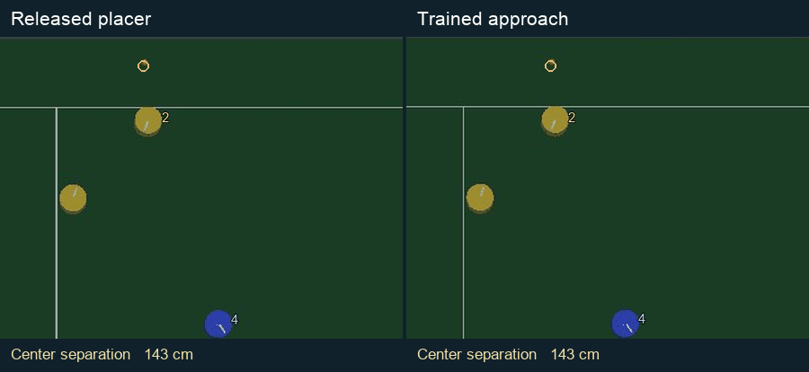

# Placing the ball in traffic

When the referee awards a touchline restart, the nearest field player collects the ball and another teammate moves into position for the free kick. An opponent can stand between the placer and the ball. This experiment measures whether the teams can finish placement with TIGERs AutoRef and the official SSL Game Controller adjudicating collisions. The fixture ends a placement trial when a foul arrives on the official broadcast.

[](../../media/placement-traffic/touchline-restart.mp4)

### What changed

A velocity planner checks how close two robot centers would come if each kept its velocity. When a requested move would bring them too close, the planner tries slowing down or changing direction. It adjusts body translation while preserving the player's yaw, roller and kick commands. This is centralized cooperative steering. It uses the measured motion and requested velocities of players on both simulated teams. An independent opponent at a tournament would supply only observed motion. [Steering code](../../src/roboturk_core/roboturk/placement_traffic.py)

The existing five-parameter capture and carry policy stayed frozen. Three generations of cross-entropy search tuned a prediction horizon (0.45 s), desired center clearance (0.34 m) and steering angle (0.52 radians). Six candidates shared four starts per generation for 72 native Webots rollouts. The reward credited settled placement and penalized close approaches and elapsed time. On 12 independent development starts both policies placed the ball. The released policy came within 18.3 cm of another robot on all 12 starts and the trained policy did so on zero. [Parameters](actor.json) · [All training and development episodes](training.json) · [Original protocol](protocol.json)

### The first 40 awards

The original placer completed 14/40 clean placements. TIGERs reported 26 crashes and the official SSL Game Controller accepted all 26. Adding trained steering raised the result to 35/40 with zero crashes and zero interference. All five missed placements reached the mark within 1.7 cm in a diagnostic replay. In each case the placer stopped on its way back, 41–56 cm from the ball, with another robot blocking the withdrawal. The two arms shared seeded requests and ball states. Webots settling introduced up to 0.36 mm of robot position difference and 1.97 degrees of heading difference before the first action. This panel missed the registered gate. [First comparison](first-comparison.json)

We then changed the programmed retreat. At release the placer chooses an outward segment that stays on the floor and clears other players' current and projected positions. The steering weights stayed fixed. All five regression cases received official confirmation in 12.6–13.1 s with no crash or interference. The revised actor and a second panel of 40 consecutive seeds were frozen at commit `7806aed` before testing the candidate. Both arms set and checked the same opening poses and velocities after the tracker warmed up. [Retreat code](../../src/roboturk_core/roboturk/placement.py) · [Second protocol](repair-protocol.json)

### Fresh paired results

| 40 new crowded awards, 20 per color | Released placer | Trained steering and revised retreat |
| --- | ---: | ---: |
| Official clean placements within 30 s | 19 | 40 |
| TIGERs crash calls accepted by the Game Controller | 21 | 0 |
| Placement interference calls | 0 | 0 |
| Episodes with robot centers closer than 18.3 cm | 35 | 0 |

The repaired policy averaged 13.31 s to confirmation. The slowest confirmation took 14.88 s. Mean final ball error was 1.67 cm and the largest was 2.10 cm. The closest two centers came was 27.7 cm. All 40 opening measurements matched exactly across policies. The officials evaluate placement through withdrawal. Reception after the kick is verified separately in the films. [Exact paired comparison](comparison.json) · [All measurements and official event payloads](evidence.zip)

In the side-by-side film, a scripted Yellow pass goes out and the officials award placement to Blue. The ball and all ten robot centers agree across every sampled frame before the award. The original approach leads to a 1.82 m/s Blue 4 collision with Yellow 2. The revised approach gives the robots 28.9 cm of center separation, then Blue 4 places the ball 1.89 cm from the mark and passes to Blue 3. An additional run of the old placer with different referee command timing also completed the restart. The matched film replays the original table timing to isolate the change in steering. [Match-speed film](../../media/placement-traffic/touchline-restart.mp4) · [Previous incident](../../media/placement-traffic/baseline-demo.json) · [Revised incident](../../media/placement-traffic/demo.json)

### Touchline exits from games

In four additional 60-second 5v5 games the teams sent one ball across a touchline. Both policies completed the placement when replayed from that exit. We also ran that seed from the opening formation through the actual reception in a single live match with both officials connected. Yellow 3 last touched the ball, Blue 2 collected and placed it, and Blue 1 controlled the 1.36 m free kick for five consecutive samples at 25 Hz. During the preceding open play, TIGERs reported two crashes at 0.88 s and 5.52 s. Both were accepted and are captioned in the film. There were zero crashes or interference reports from the touchline exit through reception. One fresh natural exit gives limited evidence about ordinary match play. [Uncut 25-second match](../../media/placement-traffic/open-match.mp4) · [Official calls and reception audit](../../media/placement-traffic/open-match.json) · [Fresh exit comparison](natural-comparison.json)

On four historical exits the baseline received confirmation in time on four and the revised actor on three. On the fourth (seed 20300002, tick 1364) TIGERs reported placement success at 25.08 s, 1.84 cm from the mark. The Game Controller recorded that success, but the robot had reached the 30 s simulated deadline before receiving it in the accelerated fixture. A separate real-time replay of this exit confirmed both policies within the deadline, at 26.20 s for the baseline and 26.16 s for the candidate. The original scored result remains 3/4. [Archived game comparison](historical-comparison.json) · [Match-speed replay](paced-comparison.json)

### Reproduce

Use the native Webots environment, Node, SSL Game Controller v3.23.1 and TIGERs AutoRef 1.7.1. The archive contains both sets of 40 starts, the five earlier misses, natural exits, film specifications, native match telemetry, original detector event payloads and Game Controller state stores. Run the two referee fixtures sequentially because they use the same local ports. Override the Game Controller, Java executable, TIGERs class directory and Webots paths using the launcher flags for your machine. [Runtime setup](../../media/autoref/README.md) · [Evidence and specifications](evidence.zip)

```sh
unzip policies/placement_v2/evidence.zip -d runs/placement-records
python scripts/run_five_roles.py runs/placement-fit --placement-batch runs/placement-records/specs/train.json
python scripts/autoref/run_placement.py runs/placement-records/specs/base-holdout.json runs/base-holdout
python scripts/autoref/run_placement.py runs/placement-records/specs/clear-holdout.json runs/clear-holdout
python scripts/autoref/compare_traffic.py runs/base-holdout/audit.json runs/clear-holdout/audit.json --repair
python scripts/autoref/run_placement.py runs/placement-records/specs/open-match.json runs/open-match
python scripts/autoref/film_open_restart.py runs/open-match runs/open-match-video --include-open-play-fouls
```

The official fixture accepts touchline, placement, interference and crash rulings. Other categories remain outside this evaluation. The simulated teams use overhead ground truth, Webots contacts, ideal body velocity actuation and an approximate dribbler. Timing of Game Controller broadcasts can vary across runs.
