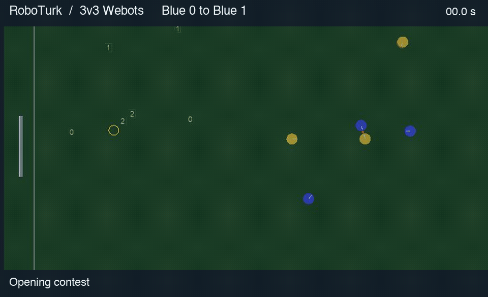

# Receiving a lead pass under pressure

The frozen 3v3 team converted **27/40 fresh opening contests** into a pressured lead reception, a sustained shield and a goal by the receiver. The prior team converted **0/40** on the same opening frames with the same closing defender. The acceptance target was 24/40.

[](../../media/pressure-receive/pressure-shield.mp4)

## The last interception

On seed 13300014, Yellow 1 passed to Yellow 0. Blue 0 closed from 0.387 m to 0.257 m during 19 consecutive samples of Yellow-only possession. At 2.14 s both dribblers reached the ball. Yellow needed 20 exclusive samples for a completed pass. [Original failure and verified replay](last-interception.json)

The frozen Yellow team replayed that seed against the original Blue policy and original press behavior. Yellow 0 received with Blue 0 0.387 m away, held sole possession for 1.42 s and scored at approximately 4.20 s. The old and new trajectories agree through the first touch, with their first difference at sample 196. Both native recordings reproduced all 1,800 states and kicks of their respective evaluation games. [Synchronized comparison](../../media/pressure-receive/matched-reception.gif) · [Physical traces](historical-2/)

## What trained

The two sides inherited the previously frozen recovery, receiver selection, lead targeting and finishing policies. For the pressure curriculum, the opponent closest to the extrapolated rolling ball pursues it on every pass. This pursuit rule is shared by both teams and the previous-team control. From the first held control tick, the receiver can carry away from the nearest opponent and pivot its roller around the ball before finishing. The closing opponent keeps moving throughout. The receiver uses the same observed world state in training and evaluation.

Return-based policy search ran 562 native 3v3 games in 6 leagues. The search varied shield translation, turn speed, hold time, dribbler centering and finishing motion. Cross-policy opponents and mirrored candidate teams played randomized starts. After the first checkpoint scored 21/40, the next search tested whether the receiver could finish a turn without losing the ball. Candidates had to repair the known interception against the original defense to make the final league. The winning candidate scored 23/28 full chains in the five-team final league. The first checkpoint scored 22/28 on those training starts. The frozen policy requests a shield speed of 0.88 m/s, a turn rate capped at 6.2 rad/s, and a minimum shield command of 0.52 s before finishing. The explicit motor rules use parameters selected by native self-play returns. Both sides use the same fixed marker pursuit rule. [First attempt and its failures](attempt-1.md) · [Second training summary](training/second-summary.json) · [Policy](policy-2.json) · [Training returns and all rollout logs](training/) · [Source freeze](freeze-2.json)

## Fresh qualification

Each of the 40 seeds starts its own native Webots process. All six robots are live from the randomized midfield contest. A scoring chain requires the opening recovery, blocked dribble lane, open teammate, committed lead target, completed pass and uninterrupted goal. At first sustained reception the nearest opponent must be within 0.75 m and moving toward the receiver at 0.15 m/s or faster. Before the shot, the receiver must hold the ball alone and keep its body between that same opponent and the ball for 20 consecutive 10 ms samples. During this interval the opponent must remain within 0.85 m and the angle from opponent to ball at the receiver must be at least 116.7 degrees. A physical trace audit checks these conditions independently of commanded actions. [Registered criteria and seed ranges](protocol.json)

| Opening outcome | Trained | Prior |
| --- | ---: | ---: |
| Pressured shield goal | 27 | 0 |
| No opening pass | 5 | 5 |
| Goal without closing pressure | 2 | 1 |
| No uninterrupted finish | 5 | 18 |
| Intercepted | 1 | 2 |
| Goal without receiver shield | 0 | 14 |

The prior team scored 15 verified lead-pass goals, of which 0 also met the pressure and shield requirements. Blue scored 15 qualifying goals and Yellow scored 12. Across qualifying receptions the median defender distance was 0.57 m, its median approach speed was 1.02 m/s, and the median uninterrupted hold was 1.20 s. The trained team recorded 0 sub-0.18 m center separations and 0 field exits across 72,000 physical samples. The matches use ideal body velocity, a spring dribbler and centralized simulator state. The result applies to the registered midfield openings in simulation. [All 40 trained matches](qualification-2/) · [All 40 matched control matches](control-2/) · [Paired comparison](comparison-2.json)

## Native Webots demo

The uncut 54-second recording includes all three separate demo openings. The team converted 2/3. An independent Webots launch reproduced all 5,400 physical states, choices and events. The excerpt shows Blue 0 leading Blue 1 by 0.33 m. The defender was 0.46 m away at reception. The overlay identifies the defender during the measured shield. The receiver scored at approximately 9.12 s. [Full MP4](../../media/pressure-receive/pressure-shield.mp4) · [All openings GIF](../../media/pressure-receive/all-openings.gif) · [Demo evidence](demo-2/) · [Independent repeat](demo-2/reproduction.json)

## Reproduction

Run from the modern RoboTurk directory with the project Python environment and the native Webots binary. The launch records include its SHA-256. The published macOS run used the R2025a nightly dated November 17, 2026.

```sh
python scripts/train_pressure_receive.py train runs/reproduce-final-league --league policies/pressure_receive_v1/training/final2-candidates.json --cases 28 --offset 1600 --webots /path/to/webots
python scripts/train_pressure_receive.py qualify runs/reproduce-pressure --version 2 --webots /path/to/webots
python scripts/train_pressure_receive.py control runs/reproduce-control --version 2 --webots /path/to/webots
python scripts/compare_pressure_openings.py runs/reproduce-pressure runs/reproduce-control runs/compare-pressure.json
python scripts/train_pressure_receive.py demo runs/reproduce-demo --version 2 --webots /path/to/webots
python scripts/record_blocked_outlet.py runs/reproduce-demo runs/reproduce-media
```
