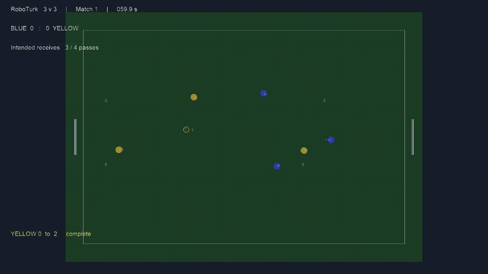

# Choosing a pass recipient in 3v3

Both trained 3v3 policies passed the reserved Webots evaluation. Across the
one-minute matches, **all six robots completed passes to each of their two
teammates**. The clock-free 90-second games also contained all 12 directed
pairings. The trace audit requires the intended receiver to take sole possession
after the actual kick.

| Native evaluation | Matches with a completed pass | Intended completions / kicks | Goals | Contacts / exits |
| --- | ---: | ---: | ---: | ---: |
| 60 s, self-play and cross-play | 32/32 | 250/371 (67.4%) | 16 | 0 / 0 |
| 90 s, open play | 6/8 | 46/61 (75.4%) | 3 | 0 / 0 |
| Fresh 60 s open-play demo | 2/2 | 10/14 (71.4%) | 0 | 0 / 0 |

All 32 one-minute evaluation games contained a completed pass in the final
30 seconds. In 90-second open play, two of eight games had a completion in the
final 30 seconds and two finished without any completed pass. Sustaining passing
late in open play remains a limitation. Geometric velocity limits intervened on
5,116 of 48,000 control ticks in the one-minute panel and 677 of 18,000 in the
90-second panel. Native physics uses ideal body velocity, spring dribbling,
fixed kick power and ground-truth state.

[](../../media/three-recipient-self-play.mp4)

*Match two, first 12 seconds at normal speed. Blue 2 completes the pass to 0.
After a return pass, Blue 2 selects 1 and Yellow intercepts. Both fresh games
ended 0–0.* [Full two-minute GIF](../../media/three-recipient-self-play.gif) ·
[Original native MP4](../../media/three-recipient-self-play.mp4) ·
[Frame counts and media hashes](../../media/three-recipient-self-play.json).

Both seeds completed 20 one-minute historical self-play matches. Replay verified
all 40 gradient updates from 199 learning-side kicked passes across both colors.
In four paired development games, the team under comparison selected the
clearer lane on 20/21 trained passes versus 15/24 random passes. Each policy
completed 14 passes. These small paired counts describe the observed games.

[Every panel, pairing and outcome](results.json) · [Training evidence](training) ·
[Paired control](paired-development.json) · [Qualified runtime freeze](freeze.json).


Six robots play one-minute Webots matches on a 9 × 6 m field. When the carrier
has a passing opportunity, a shared linear scoring function evaluates both
teammates. Each candidate has six features measured relative to the carrier,
ball, goal and three opponents. These describe passing lane clearance, marking
distance, forward progress, range, turn angle and receiver orientation. Robot
IDs identify recipients and do not enter the score. Choosing deterministically
at deployment uses the same features as sampling a receiver during training.

Each seed starts near uniform and plays 20 native matches. The learning side
alternates colors and faces a sampled historical receiver policy. Both teams
sample receiver choices. The score-function policy gradient uses +1 for an actual
intended reception and −1 for an interception, timeout, restart or end of match
after a kicked pass. Only the learning side updates its six parameters after each
match. Its checkpoint joins the opponent pool every four matches.

The pass motor comes from the previous ten-skill release. The 3v3 experiment
trains recipient selection. Carrying, shooting, support, defensive coverage,
receiver motion and geometric velocity limits use explicit controllers. The
carrier can keep the ball when both lanes are crowded. The game uses a 12-second
possession clock and randomized restarts after expiration, a goal or a ball-out.
Each restart permutes the robot IDs and places a defender near one candidate
lane. All six robots move throughout each match.

An intended reception requires a real kick, 0.55 m of ball travel and at least
0.20 seconds of exclusive mouth possession by the selected robot within four
seconds. An opponent or the other teammate taking the pass ends the attempt.
The audit checks the outcome against 10 ms native position samples and checks
the selected teammate against the policy's recorded candidate scores.
[Protocol and test cases](protocol.json).

The main qualification is 32 held-out one-minute matches. A separate eight-match
open-play challenge extends the clock to 90 seconds and removes shot-clock
restarts. The two consecutive uncut one-minute demo matches use the same open-play
rules. Goal and ball-out restarts remain active in both formats.


To reproduce on the pinned Webots build, run the launcher from the modern project
root with the isolated environment active. It writes a fresh directory for each
experiment. Training requires the prior frozen pass motor. Qualification and the
demo also load the two released recipient selectors and check the frozen files.

```sh
python scripts/run_three.py --webots /path/to/webots --mode train --seed 901 --output runs/new-league-901
python scripts/run_three.py --webots /path/to/webots --mode train --seed 902 --output runs/new-league-902
python scripts/run_three.py --webots /path/to/webots --mode qualify --output runs/replay-3v3
python scripts/run_three.py --webots /path/to/webots --mode open --output runs/replay-3v3-open
python scripts/run_three.py --webots /path/to/webots --mode demo --output runs/replay-3v3-demo
```
