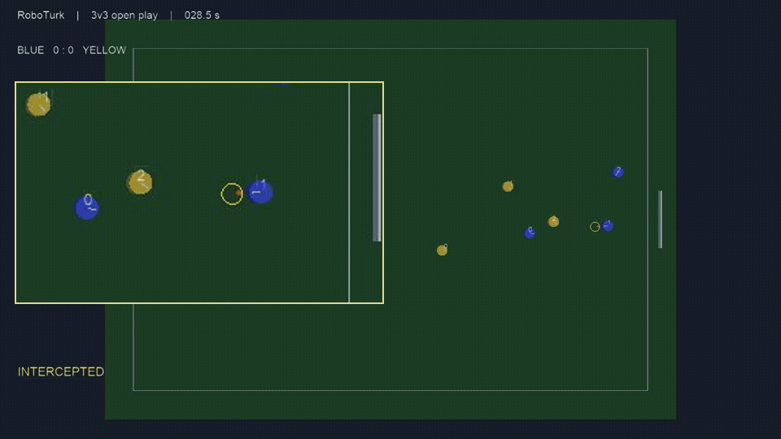

# Scoring after recovery under pressure

The first scoring policy improved on the previous outlet team in two independent studies. It converted 28 of 60 opening contests, below the target of 36. Training records showed that recovering players sometimes lost the ball while turning and sometimes shot out or into an intercepted lane. [First policy and all 174 games](../recovery_attack_v1/README.md)

This experiment gives the ball carrier four additional combinations of turn speed and motion away from a nearby opponent. During a pass or shot the carrier can pivot around the ball while translating. The new shot planner compares seven points inside the goal and estimates where intervening robots will be when the ball reaches them. Every configuration uses the same kick speeds, field, 3v3 defenses and underlying Webots contacts. The original controller is also available in training.

Both colors play each of 120 training layouts under five motor configurations. The learner selects the control with the highest count of actual opening-recovery goals. On a further 300 layouts it tries each of pass, dribble and shoot and fits opening returns from the resulting play. Five-fold validation keeps all trials of a layout in the same fold. The published protocol specifies the development comparison and held-out thresholds. [Protocol and seed ranges](protocol.json)

## Independent Webots results

The selected opening improved over the previous outlet team and missed two prespecified thresholds. Every game used a fresh process. On the 40 matched contested starts the first physical frame agreed across configurations to within 0.0000001 in each recorded coordinate.

| Teams and starting conditions | Opening goals / games | Recovery goals / recoveries | Pass-assisted goals | Dribble-assisted goals |
| --- | ---: | ---: | ---: | ---: |
| Previous outlet teams, contested | 3/40 | 4/53 | 4 | 0 |
| New teams, contested | **17/40** | **22/48** | 3 | 12 |
| New team against previous team, contested | 4/24 | 5/25 | 1 | 4 |
| New teams, ordinary 60-second open play | 2/12 | 4/11 | 0 | 2 |

The trained teams converted all three opening contests the previous teams converted and 14 additional starts. The threshold was 24/40. Blue scored 12 recovery goals and Yellow scored ten. The learned strategy chose dribble 37 times, shoot 34 times and pass 17 times. The carry metric requires an explicit dribble option, which the previous outlet team does not emit.

In head-to-head play the new side won eight opening recoveries and scored four opening goals against the target of six in 24 games. Across all recoveries the new side scored 4/10 and the previous side scored 1/15. In ordinary open play the four recovery goals occurred in four different games. The physical audit found no robot exits or samples with center separation below 0.18 m. Pass-assisted and dribble-assisted counts can overlap. The simulator supplies ground-truth poses, ideal body velocity, a spring dribbler and fixed kick speeds. [All games and audit checks](qualification/audit.json) · [Evaluation protocol](protocol.json)

## Motor results

| Maximum turn rate (rad/s) | Escape speed coefficient (m/s) | Opening goals / 120 | Pass-assisted | Dribble-assisted |
| --- | ---: | ---: | ---: | ---: |
| Original motor | 0 | **80/120** | 11 | 36 |
| 4.4 | 0.28 | 71/120 | 9 | 27 |
| 5.5 | 0.55 | 66/120 | 6 | 31 |
| 6.8 | 0.85 | 74/120 | 5 | 29 |
| 5.5 | 1.15 | 64/120 | 6 | 18 |

The original motor won the selection. The additional opening-policy study therefore keeps the original pivot and shot planner. Training counted goals from native poses using the same recovery and goal-line rules as evaluation. The training archive stores the resulting episodes and decisions. Each held-out game also saves all physical samples for independent replay.

## Learned decisions

The opening study ran 900 trials. The selected estimate used 18 neighbors for a dribble or shot and ten for a pass. Grouped cross-validation selected a six-point pass-success bonus for the opening-value estimate. Subsequent decisions still use the learned continuation values from the first study. Both teams use the same decisions with their respective goal directions.

On 32 identical development starts, the original opening converted 19 initial contests. The new opening converted 20, with 25 goals from 45 recoveries overall. Four goals followed a completed pass and 13 followed a controlled dribble. The new opening and original opening ran in a fresh Webots process for every game. The action model was frozen on GitHub before independent testing. [Training episodes and fitted estimates](training.json.gz) · [Both development panels](development.json) · [Frozen weights](policy.json) · [Source hashes](freeze.json)

## Watch the decisions

[](../../media/recovery-shield/recovery-to-goal.mp4)

In the ordinary match Yellow 2 establishes sole possession at 29.94 s, dribbles 0.402 m and scores at 31.27 s. All 6,000 recorded states and all events matched the original held-out game when it was rerun with rendering. The second excerpt is a different game. Yellow 0 wins sole possession at 0.74 s and passes at 1.80. Yellow 1 completes the reception at 3.08, shoots at 4.36 and scores at 5.31. The 0.32-second black frame sequence separates the clips. [Full ordinary game](../../media/recovery-shield/recovery-finish.mp4) · [Ordinary replay comparison](open-play-demo/audit.json) · [Source times and media hashes](../../media/recovery-shield/recovery-choices.json)

The three additional 35-second demo games ran on the prespecified seeds. The first two began with contested fixtures and each produced a recovery goal. The third began in ordinary play and produced one referee goal. A separate native Webots launch reproduced every one of the three games' 10,500 physical samples, strategy choices, referee events and recovery attributions. [Uncut 105-second recording](../../media/recovery-shield/recovery-to-goal.mp4) · [Full GIF](../../media/recovery-shield/recovery-to-goal.gif) · [Demo scores](demo/audit.json) · [Repeatability results](demo/repeatability.json)

## Reproduce

Use the project's isolated Python environment with the native Webots binary available. Both launchers accept an explicit binary path via `--webots`. The test measures uninterrupted possession, intended receptions, actual kicks and goal-line crossings at 100 Hz.

```sh
python scripts/verify_shield_training.py
python scripts/run_shield_attack.py qualify runs/new-shield-qualification
python scripts/audit_shield_attack.py runs/new-shield-qualification
python scripts/run_shield_attack.py demo runs/new-shield-demo
python scripts/audit_shield_attack.py runs/new-shield-demo --demo
python scripts/build_recovery_goal_demo.py runs/new-shield-demo --media runs/new-shield-media
python scripts/run_shield_attack.py ordinary-movie runs/new-shield-ordinary --qualification runs/new-shield-qualification
python scripts/check_recovery_showcase.py runs/new-shield-ordinary runs/new-shield-qualification --media runs/new-shield-media
python scripts/build_recovery_choices.py runs/new-shield-media runs/new-shield-demo
python scripts/run_shield_attack.py demo runs/new-shield-demo-repeat
python scripts/compare_recovery_demos.py runs/new-shield-demo runs/new-shield-demo-repeat runs/new-shield-demo/repeatability.json
```
