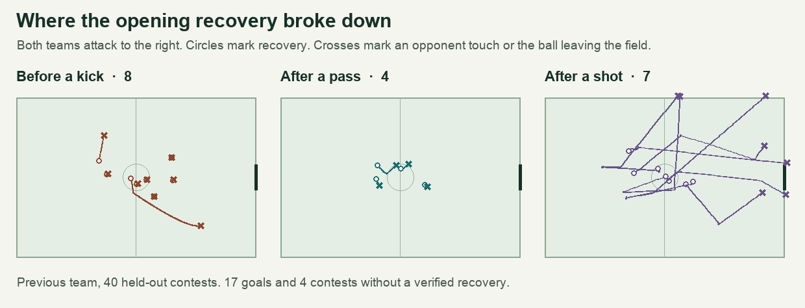
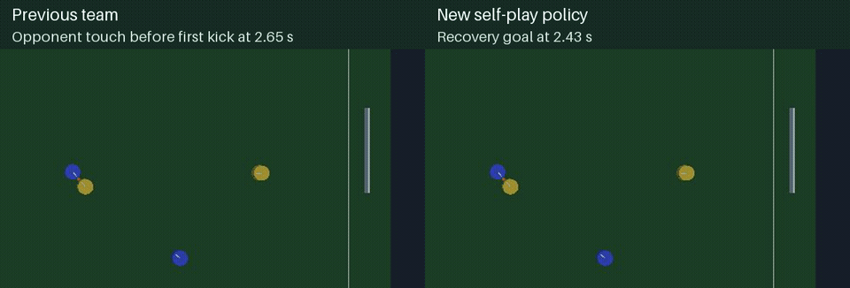

# Converting the opening recovery in 3v3

We examined all 40 opening contests from the second recovery team's held-out Webots test before training the next policy. The ball and all six robot poses were recorded at 100 Hz. Turnover time begins when one of the contestants has controlled the ball alone for 0.20 seconds. A pass in flight counts as a live attack until an opposing mouth touches the ball or the referee stops play.



| Opening outcome | Games | Median time after recovery |
| --- | ---: | ---: |
| Scored from the first recovery | 17 | |
| Opponent touched the ball before the first kick | 8 | 0.07 s |
| Opponent touched the ball after a pass | 4 | 0.65 s |
| Opponent touched the ball after a shot | 2 | 4.72 s |
| Ball went out after a shot | 5 | 5.74 s |
| Neither contestant established a verified recovery | 4 | |

Six of the eight pre-kick turnovers happened within 0.08 seconds. The four pass interceptions ended near midfield, with median attacking-frame x of 0.09 m. The native trajectories show shots going out both near the goal and over the touchline. [Every opening, outcome and location](predecessor-losses.json) · [Original traces](../recovery_attack_v2/qualification/trained)

An additional check covered every spontaneous recovery in the previous team's twelve one-minute games. Of eleven recoveries, four led to goals and four were lost to an opponent before a kick. One ended with an opponent touch after a pass, one after a shot, and one reached the time limit before a kick. [Ordinary-play loss records](ordinary-losses.json)

## Self-play

During the transition from joint to sole possession, the controller tracks ball velocity and centers the moving ball in the robot's front mouth. A carrier can rotate to aim while translating. The learned team policy chooses a pass, dribble or shot using the available goal opening, pressure, alignment, distance to goal and the lead-pass route. Teammates clear the shooting lane or move to the intended receiving point. Both colors learn from actual Webots games, with normal opponent commands, kick speeds and contact physics.

The policy search tries several combinations of ball tracking, dribble speed, escape velocity and decision weights on the same layouts. Each candidate earns a point only for a physically verified goal from the opening contest. Ties favor successful passes and then controlled carries. Every game in the 40-start qualification gets an independent Webots process, with the same field, contest distribution and scoring audit as the previous team. [Registered protocol](protocol.json)

In the first league, each of six policies played 48 training starts. Their opening-goal counts were 37, 30, 37, 32, 37 and 32. The three policies tied at 37 scored 18, 17 and 23 dribble-assisted goals respectively. The top two advanced alongside four variations that give more weight to an available pass. [First league returns](initial-returns.json) · [Training records](initial-training.json.gz)

## Frozen team on 40 fresh starts

**32/40 opening contests (80%) became a goal for the team that recovered the ball.** The registered target was 24/40. The model and runtime were frozen at commit 696c5c7 before the test. All forty 24-second matches included the same six active players and ran in separate native Webots processes.

| Measure | Result |
| --- | ---: |
| Opening contests converted by Blue / Yellow | 13 / 19 |
| Opening goals following a controlled dribble of at least 0.18 m | 23/32 |
| Opponent touch before the first kick | 4/40 |
| Shot went out | 4/40 |
| All recovery goals / verified recoveries, including later play | 41/52 |
| Dribble choices / shot choices / pass choices across the full matches | 71 / 50 / 0 |
| Robot exits / samples with robot centers closer than 0.18 m | 0 / 0 across 96,000 samples |

The selected controller favored carrying and shooting throughout these fixtures. Passing remained an available decision. The earlier passing policies and their evaluations are linked from the project page. A qualifying goal requires an actual 4 m/s shot through the opponent's goal, an uninterrupted recovery and a physical check against the ball trajectory.

The second six-policy league produced 39, 37, 40, 48, 39 and 38 opening goals on 56 layouts each. The selected policy's 48 goals included 35 controlled carries. It then converted 16/24 independent development starts. The qualification used a separate seed range, 11400000–11400039. [Frozen policy](candidate-1.json) · [Source and training hashes](freeze-1.json) · [Second league](training-1.json.gz) · [Development](dev1/audit.json) · [Qualification and individual seeds](qual1/audit.json) · [All eight misses](qual1/losses.json)

## Same starts with the previous team

The previous recovery team scored from **20/40**, compared with **32/40** for the frozen first-touch team. The first frame matched exactly in all 40 pairs. The new team converted fourteen starts that the previous team missed and lost two that it previously converted. [Per-start comparison and physical outcomes](baseline1/comparison.json)

| Opening result | Previous team | New team |
| --- | ---: | ---: |
| Recovery goal | 20 | 32 |
| Opponent touch before first kick | 6 | 4 |
| Opponent touch after pass | 3 | 0 |
| Opponent touch after shot | 3 | 0 |
| Ball out after shot | 8 | 4 |

[](../../media/recovery-transition/matched-recovery.mp4)

The synchronized excerpt shows one of the fourteen newly converted starts, seed 11400024. On the left, the opponent touches the ball at 2.65 s, before the previous team's first kick. On the right, Blue 2 establishes possession at 0.89 s, carries the ball 0.507 m, shoots at 1.52 s and scores at 2.43 s. Both recordings reproduced all 2,400 states and decisions of their original games. [Full previous-team game](../../media/recovery-transition/previous-matched-game.mp4) · [Full new-team game](../../media/recovery-transition/trained-matched-game.mp4) · [Exact replay evidence](../../media/recovery-transition/matched-recovery.json)

## Fresh Webots demo

The prespecified 35-second games produced three recovery goals. Blue scored once in the first game and twice in the second. The ordinary-play third game ended scoreless. The main excerpt shows the second game's recovery at 14.80 s. Blue 2 carries the ball 0.60 m, shoots at 17.24 s and scores at 19.23 s. The full recording plays all three games in order at normal speed. Repeating the entire sequence in a fresh Webots process reproduced all 10,500 physical samples, options, events and recovery attributions. [Native MP4](../../media/recovery-transition/recovery-to-goal.mp4) · [Highlight GIF](../../media/recovery-transition/recovery-goal-play.gif) · [Complete GIF](../../media/recovery-transition/recovery-to-goal.gif) · [Repeatability audit](demo1/repeatability.json)

## Reproduce

Run from the modern project in its training environment. The native launcher accepts `--webots /path/to/webots`. The published run used the project's R2025a nightly, ideal body-velocity drive, fixed kick speeds, spring dribbler and ground-truth poses.

```sh
python scripts/select_recovery_transition.py verify 1
python scripts/train_recovery_transition.py qualify runs/new-transition-test --policy policies/recovery_attack_v3/candidate-1.json
python scripts/recovery_losses.py runs/new-transition-test runs/new-transition-test/losses.json
python scripts/train_recovery_transition.py demo runs/new-transition-demo --policy policies/recovery_attack_v3/candidate-1.json
python scripts/build_recovery_goal_demo.py runs/new-transition-demo --media runs/new-transition-media
python scripts/compare_transition_panel.py runs/new-transition-test runs/new-transition-previous
python scripts/replay_transition_pair.py runs/new-transition-test runs/new-transition-previous runs/new-transition-pair
python scripts/encode_transition_pair.py runs/new-transition-pair runs/new-transition-media
```

The optional plot and paired-video title tools use Pillow. The two self-play leagues can be reproduced with `search --cases 48`, the `refine` command and a second `search --cases 56 --first 11201000 --candidates <refined.json>`. Each archive contains the exact launch parameters, selected actions, kicks, outcomes and policy returns.
