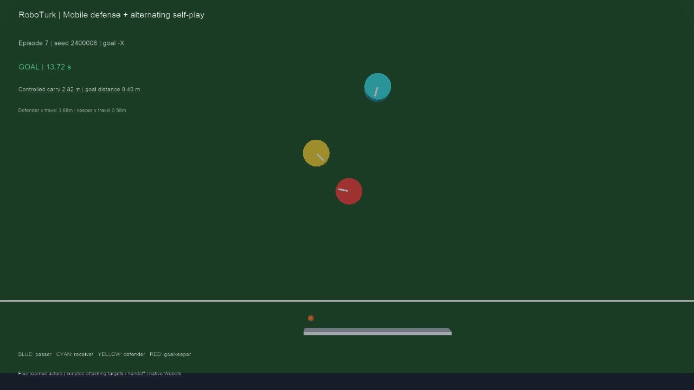

# Mobile defense and alternating self-play v1

Qualified November 19, 2026 (America/Los_Angeles), in native Webots R2025a
nightly17/11/2026. Five generations alternated PPO updates across defender, keeper,
transfer and finishing policies against retained historical opponents. All three
untouched reserved panels passed their predeclared gates.

| Reserved panel | Goals | Defensive stops | Clean outcomes | Collisions | Unforced errors |
| --- | ---: | ---: | ---: | ---: | ---: |
| Final attackers / final defense | 78 | 116 | **194/200** | 2 | 4 |
| Final attackers / bootstrap defense | 19 | 80 | **99/100** | 0 | 1 |
| Bootstrap attackers / final defense | 47 | 50 | **97/100** | 1 | 2 |

**Clean means a goal or a legitimate defensive stop, not an attacking win.**
The final pair scored 78/200 (39%) and stopped 116/200 attacks (58%): 100 defender
interceptions and 16 keeper saves. Its six failures were two defender collisions,
one possession loss, one keeper field exit, one invalid pass and one attacker field
exit. Clean-outcome Wilson 95% interval: 93.61–98.62%; goal interval: 32.51–45.91%.
The historical attack panel had one timeout; the historical defense panel had one
collision, one possession loss and one timeout. All failures remain in the raw files.
These are observed rates on the declared distribution, not future-game guarantees.

[Final-pair outcomes](qualification-final.json) / [audit](qualification-final-audit.json) ·
[Attack panel](qualification-attack.json) / [audit](qualification-attack-audit.json) ·
[Defense panel](qualification-defense.json) / [audit](qualification-defense-audit.json).

## Native demo

[Watch the complete 73.2-second Webots movie](../../media/mobile-self-play-demo.mp4).
All eight predeclared consecutive cases are included in their original order:
three interceptions, three keeper saves and two goals; zero collisions, field exits
or unforced failures. The two goals are episodes 7 and 8, starting at 47.62s and
61.94s. Four episodes attack each goal direction. This small demo illustrates the
policies; the separate 400 reserved games establish the reported panel rates.

Blue: passer; cyan: receiver/scorer; yellow: defender; red: goalkeeper.
All 1,830 frames are retained at 25fps, 1280×720 and normal simulation speed.
Both native and compressed movies fully decoded; all eight terminal frames plus
pass/reception and dribble/pursuit frames were inspected. A 0.6s outcome display
follows each terminal event, with robot HALT; ball motion can continue during the
display and is excluded from episode scoring. [Raw demo](demo.json),
[audit](demo-audit.json) and [video hashes/provenance](demo-video.json).

## Learned control and movement freedom

The defender and keeper each use a 45-input/three-output actor for planar velocity
and rotation. Nearby robots, ball and role geometry are observations. No line or
goal-area position clamp, analytic motion fallback or runtime spacing projection
provides defensive actions. Defender speed is 0.55–0.85m/s, keeper 0.8–1.15m/s,
with acceleration bounds and 0.04–0.10s keeper command latency. The wider observation,
training and speed distribution provides the new freedom; old neural opponents
already lacked a hard position clamp.

The 70-input/seven-output transfer actor controls both blue robots until stable
reception; the 36-input/four-output finisher then controls the receiver. Four policy
roles therefore do not mean one independent policy per physical robot. Receiving
flank feints, setup/aim targets, phase transitions, role handoff, kick powers and
dribbler masks remain scripted. Motion and kick decisions are neural. Both opponents
remain active across the continuous handoff with no world reset.

In the 200-case final panel each defender made 82,189 inference calls, with four
physics checks per control step. The defender's maximum x/y excursions were
4.076/2.250m; the keeper's were 0.670/0.419m. Mean x/y excursions were
1.692/1.234m and 0.315/0.167m respectively. Full distributions are in the audit.

## Training and retained failures

Bootstrap: 200 teacher plays, 60 cloning epochs, 100 mixed DAgger plays and 40 refit
epochs per actor. Self-play: five generations × four roles × 32,768 PPO steps =
**655,360 steps**, 637 accepted / 640 attempted updates across 20 role jobs. Every
actor changed in every generation. Three final-generation keeper updates were
rejected by the trust-region check. Six snapshots (bootstrap plus G1–G5) remain
available. The [training audit](training-audit.json) checks model lineage, historical
bytes and training-only reset seeds. The older artifacts/training-audit.json is the
retained four-generation audit, not the final total.

Defensive supervised spacing preparations preceded generations 4 and 5. A mobile
setup transition correction to 0.14m/0.10rad also removed a scripted phase stall;
precise neural aiming/kicking stayed unchanged. Neither improvement is attributed
to PPO alone. Failed whole-actor and kick-readout refits were retained but not used
in the final bundle. Training ran on one CPU thread and one native simulator.

Generation-five broader development was 99/100 clean for the final pair, 94/100
against bootstrap defense (six collisions, failed gate), and 96/100 for bootstrap
attackers against final defense. The full 6×6 cross-play matrix contains 720 games;
its final/final cell was only 18/20 clean (one invalid pass, one possession loss).
All failures remain even though the later reserved panels passed. These are mixed
robustness results, not evidence of monotonically improving strength or isolated
PPO benefit. [Full matrix](artifacts/cross-play-matrix.json) and
[complete development history, amendments and replay commands](../../docs/SELF_PLAY.md).

## Freeze and evaluation protocol

The last completed generation was selected using development evidence and frozen
at 2026-11-19T16:45:07.614215−08:00. [Freeze](freeze.json), [selection](selection.json)
and 483 retained artifacts were published at
[a143963](https://github.com/kadiru/metu-ros-pkg/commit/a143963da3e7cc7d2061276e4c1b500d0e3b5d8c)
before any reserved reset. All 583 compared remote files matched local Git blobs.
[Publication receipt](publication.json). No model, runtime or selected artifact
changed after freezing; reserved observations never entered training.

Seeds: final pair 2300000–2300199; final attack/bootstrap defense 2310000–2310099;
bootstrap attack/final defense 2320000–2320099; fresh demo 2400000–2400007.
Every panel requires at least 95% clean outcomes, at most 2% collisions and at most
3% unforced errors. Final-pair goals must reach 20%; final defense must stop at
least 20% of bootstrap attacks. These are point-estimate gates, not lower confidence
bound guarantees. No outcome selection, resampling or post-qualification tuning.

Audits require actual applied pass, stable reception, retained carry, applied shot
and whole-ball goal crossing. Defensive stops use contact-distance or modeled
mouth-possession predicates; they do not establish sustained capture or measure
ODE contact sensors. Robot collisions are failures, including after a shot.

| Final actor | Checkpoint SHA256 |
| --- | --- |
| defender | `ef0e9a73f29488d37b4302c3e3f2342f39c0a8e225732b990098c6e7e5202abc` |
| keeper | `87e14001b27755ecef88ad8d554f90f34a806fcd8e47caef0dd85be3a7098ddd` |
| transfer | `f55cc19989397f6c7965f9a2612b7aea300f648f616b20b9dcae3eb5b5bad42a` |
| finish | `3310235fa2a121234ae51264c72510184feb136c8e6c6e8c87708bdb504f0534` |

## Scope and provenance

This is a repeated two-attacker versus defender/keeper drill with initial passer
possession, ground-truth state, ideal body velocity, ODE contacts, a spring dribbler
and velocity kicks. It does not qualify full-match tactics, official SSL rules,
perception/noise robustness or calibrated hardware. Live ROS/Webots applied-kick
feedback and end-to-end graph validation remain separate; core and ROS build/tests
run in CI. Local validation: 116 tests passed, one ROS-only module skipped; Ruff clean.

The [behavior-source catalog](../../docs/BEHAVIOR_SOURCES.md) retains CMDragons2015
blocking/coverage/support, TIGERs Mannheim2025 pass decision/execution/outcome
separation and ER-Force2024 keeper prediction/reversal inspiration. Those teams'
methods are not described as this RL implementation. Historical-opponent sampling
is informed by [Bansal et al.](https://arxiv.org/abs/1710.03748); this small alternating
pool is not a population-scale reproduction or equilibrium claim.
