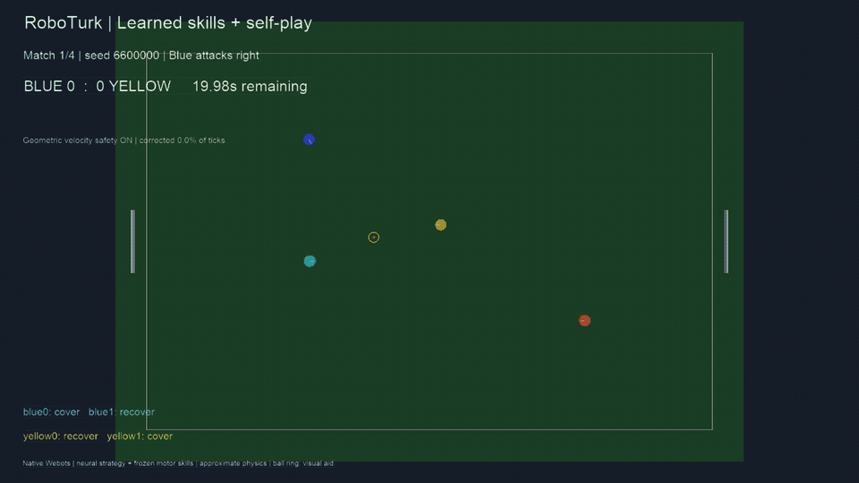

# Learned skills in continuous self-play

Receive-and-stop, one-touch redirect and recover-and-clear now run inside a
learned ten-skill 2v2 strategy. Both independent training seeds passed every
predeclared gate across **120 reserved native Webots matches**. The four fresh
uncut demo matches also passed their physics and checkpoint-inference audits.

[](../../media/learned-skills-self-play-demo.mp4)

The full-length GIF runs for 80 seconds at normal speed. The native MP4 retains
all 1,999 frames: 79.96 seconds, 1280×720, 25 fps, without cuts or reencoding. Scores in
order: 0–1, 0–0, 1–0, 0–0. A stopped reception occurs near 0:22.28, the redirect goal
near 0:42.52, and the completed defensive clearance near 1:01.76. All four cases
remain visible, including scoreless play and missed opportunities.

## Reserved qualification

Each seed has 60 full 20-second matches: 20 self-play, 20 against its initial
checkpoint, and 20 against the other trained seed. Counts include both teams.

| Training seed | Completed | Goals (blue / yellow) | Receive-stop | Redirect kicks / goals | Clearances |
| --- | ---: | ---: | ---: | ---: | ---: |
| 811 | 60/60 | 22 (14 / 8) | 13 | 14 / 13 | 16 |
| 822 | 60/60 | 23 (8 / 15) | 15 | 15 / 12 | 17 |
| Total | **120/120** | **45** | **28** | **29 / 25** | **33** |

There were 371 passes, 55 stable receptions and 79 draws. Receive-stop uses a stricter
metric than the base reception counter: 0.5 seconds of exclusive stopped possession
following a real teammate pass. Redirect timing and whole-ball goals, and stable
control before a clearance through an outlet, are independently reconstructed
from the native 5 ms traces. Selecting a skill is never counted as its success.

All 480,000 physical samples passed independent geometry audits. Replaying the
published checkpoints on the native states reproduced all 480,000 robot decisions,
intent entries/refreshes/exits and motor-call counts. Every case is retained;
none was dropped, rerun, or used for subsequent tuning. No contacts or field exits
were detected. The geometric translation filter changed 32.998% of ticks for 811
and 35.042% for 822; collision avoidance therefore partly relies on explicit safety.
This establishes the declared bounded functional gates, not a guaranteed goal,
win, or isolated self-play improvement.

[Exact per-seed gates and per-panel results](qualification-summary.json) ·
[Complete native traces, launches and audits](preparation/qualification-v1) ·
[Predeclared protocol](protocol.json) · [Demo receipt](demo-summary.json)

## Learned orchestration and training

The 162-observation selector chooses recover, dribble, pass, shoot, press, cover,
support, receive, redirect or clear. Its 31 raw outputs contain ten choice logits
and three separate seven-value intent heads, packed into 17 deployed values.
Intent targets latch on entry and change only when the neural refresh output
requests it; exit is a learned choice. All four robots move and can change
responsibility. No scripted playbook, tactical target planner or handoff executes
at inference. Direct geometry features improve aiming precision, with learned
coefficients on all choice and target outputs.

Native coaching and mixed DAgger prepared the selectors. A separate 16-input,
four-output pass motor was fitted from 20,891 training-range native states before
strategy training. The original continuous and TDP motor files remain unchanged.
The selected pass motor and all other motors and target functions stayed fixed
through two historical self-play generations per seed: 131,072 native PPO steps,
113/128 accepted updates (58 for 811, 55 for 822). Audits confirm changed choice actors,
all four learner roles and sampling of retained opponent checkpoints.

The final generation per seed was selected after 64 fresh development matches.
Failed earlier preparations, exploratory models excluded from the candidate
pipeline, launch errors, datasets and exact launch-time sources remain under
[preparation](preparation). No isolated PPO benefit is claimed.
[Architecture and retained failures](../../docs/LEARNED_SKILL_STRATEGY.md) ·
[CMDragons, Thai Skuba and TIGERs inspiration](../../docs/TDP_SKILL_PACK.md)

## Freeze and reproduction

The 117 model/runtime dependencies and protocol were frozen at
[0081223](https://github.com/kadiru/metu-ros-pkg/commit/008122327014feaba4e9f05a73381a0bd2d73681).
All 457 files in that publication, including development evidence, were independently
verified against remote Git blobs before reserved evaluation. The
[publication receipt](freeze-publication.json) precedes every reserved launch.
The frozen runtime and both prior qualified releases remain unchanged.

From the modern project root, with the pinned Webots build and isolated Python
environment, reproduce the complete demo:

```bash
python scripts/run_strategy.py --webots /path/to/webots \
  --mode demo --render --episodes 4 --seed 6600000 --duration 20 \
  --checkpoint policies/strategy_self_play_v1/seed811/generation2/policy.zip \
  --opponent policies/strategy_self_play_v1/seed822/generation2/policy.zip \
  --pass-motor policies/strategy_self_play_v1/preparation/pass-motor-v5/policy.pt \
  --freeze policies/strategy_self_play_v1/freeze.json \
  --output runs/reproduce-strategy-demo --timeout 1800
```

The launcher checks every frozen hash and refuses existing output paths. Reusing
these seeds reproduces known cases, not a new reliability estimate. To reproduce
a training league, use `--mode train --training-seed 811 --rounds 2 --steps 32768`,
the `policies/strategy_self_play_v1/preparation/heads-v6/seed811/initial.zip` checkpoint, the same pass motor,
`--duration 20`, and a fresh output directory; omit demo/freeze arguments. Repeat
serially for 822. Packaged dataset hashes are verified when original paths are absent.

## Scope

Approximate ground-truth Webots physics: ideal body velocities, spring dribbling,
fixed-power velocity kicks and simplified referee restarts. Tactical starting
opportunities vary team, robot identity, geometry and attack direction; subsequent
restarts use loose-ball formations. These are 20-second 2v2 matches. No official
SSL match, calibrated hardware, noisy perception/radio, complete live ROS graph,
or broader match-strength claim is made. The ROS 2 interfaces remain available;
core and ROS CI validate their software contracts separately from this native run.
