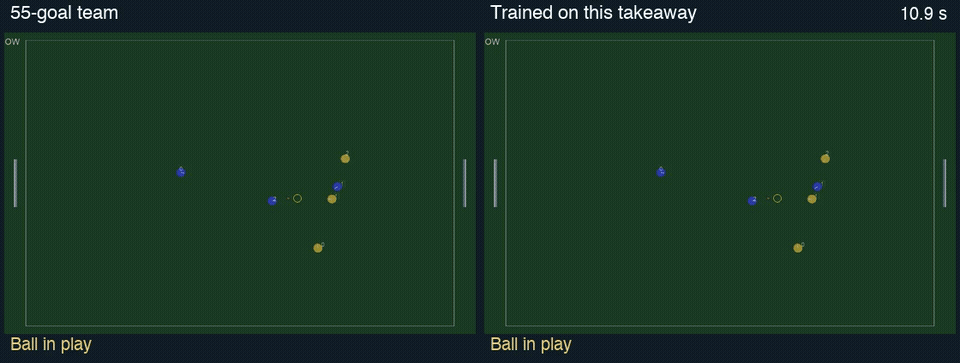

# Scoring after a clean takeaway in 3v3

The calibrated team scored **73 goals from 391 clean takeaways** in 40 fresh, 90-second native Webots matches. The 55-goal team scored **1 from 12** on identical kickoffs. Each team played itself with both sides using the same checkpoint. The middle column shows the policy before it trained on the three old plays. [Paired match results](comparison.json) · [Independent checkpoint comparison](general-comparison.json)

| On the same 40 starts | 55-goal team | Interception training | Plus historical fine-tune |
| --- | ---: | ---: | ---: |
| Clean takeaways | 12 | 303 | 391 |
| Clean-takeaway goals | 1 | 42 | 73 |
| Clean-takeaway conversion | 8.3% | 13.9% | 18.7% |
| Starts with a clean-takeaway goal | 1 | 28 | 30 |
| All open-play recovery goals / recoveries | 157/483 (32.5%) | 55/338 (16.3%) | 89/424 (21.0%) |
| All scoreboard goals | 160 | 66 | 108 |

The calibrated mirrors produced 16 goals after contested wins. The old mirrors produced 156. Both sides change in a mirror match. Across the 391 clean steals, 161 ended with an opponent touch and 111 with the ball out. Time expired on 29, and 17 scoring sequences failed the pass or shooter verification.

The calibrated team averaged 1.80 extra clean-takeaway goals per match, with a paired 95% bootstrap interval of +1.35 to +2.30. It scored more of these goals on 30 starts, tied on 10 and scored fewer on none. The earlier 55 goals came from contested wins on a separate 16-start panel. [All fresh event logs and 100 Hz traces](evaluation/) · [Matched old-team games](control/) · [Independent checkpoint games](general/)

Against one another on the first eight starts with colors swapped, the calibrated side won 11, drew 3 and lost 2. Its scoreboard total was 44 to 21. It scored 22/82 (26.8%) from clean takeaways, compared with 7/24 (29.2%) for the old side. Both teams played through every restart. [Opening states and scores by color](comparison.json)

The historical fine-tune added 31 clean-takeaway goals over the 40 paired starts. The attacking sprint converted 55 of 170 opportunities and the deep sprint converted 10 of 22. The touchline move had no eligible fresh steals on this panel. For each match we checked that the two native trajectories agreed until the first eligible regional move. [Regional decisions and paired changes](calibration-effect.json)

## The original three possessions

| Recovery | What the old team did | Frozen team from the identical recovery | Interception enabled one second earlier |
| --- | --- | --- | --- |
| Blue 2 at 11.73 s | Completed a pass to Blue 0. The opponent touched the ball before a shot. | Goal by Blue 2 at 15.28 s | Opponent touch after 1.02 s |
| Blue 0 at 49.14 s | Chose a shot and carried along the touchline. The ball went out without a kick. | Goal by Blue 0 at 52.88 s | Original player did not make a nearby clean takeover |
| Blue 2 at 78.73 s | Lost the ball to another touch 0.14 s after winning it. | Goal by Blue 2 at 82.56 s | Opponent touch after 0.10 s |

Each exact replay keeps the previous opponent and every physical sample through the original recovery. Only the recovering side changes its next decision. The last column starts the learned interception one second earlier and checks whether the same player takes the ball in the next four seconds. An absent recovery earns no goal. The three historical cases contributed to the fine-tune. [Original diagnosis](original-three.json) · [Exact replay evidence](historical/) · [Earlier intervention evidence](historical-early/)

[](../../media/clean-takeaway/three-repaired-takeaways.mp4)

The montage shows the three plays in their original order. On the touchline play, both sides of the clip match through 49.16 seconds. Blue 0 then escapes and scores at 52.88 seconds on the right. The old team sends the ball out at 58.16 seconds on the left. [All three previous losses on film](../../media/clean-takeaway/three-takeaway-losses.gif) · [Repair recording checksums](../../media/clean-takeaway/repair.json)

## What changed in self-play

The independently trained team searched 11 post-recovery maneuvers at 24 natural turnovers from prior training matches. Every branch used the same original trajectory through the decision. The reward was a physically verified goal before the next opponent touch or stoppage. Holding each training kickoff seed out in turn selected depth 1. It learned an outside escape when the ball was more than 0.086 m inside its own half and a shield-then-shoot move farther upfield. A separate league played 48 full 75-second mirror and cross games on eight new training starts. It selected interception profile 1. The selected defender screens the likely receiver, positions itself 0.48 m in front of the carrier, and looks for an intercept about 0.35 s ahead on a rolling ball. [Option returns and model selection](fit.json) · [Interception league](press-selection.json) · [Full league games](press-training.json.gz) · [General checkpoint](policy.json)

The targeted training ran 47 additional native branches on the three named plays. A scoring branch earned one point. The team learned a narrower shot release near the touchline and selected two sprint profiles for steals deep in its own half and under pressure in attack. Ordinary matches select the move using field position and distance to a defender. The clock and seed are only used by the diagnostic harness to replay a particular historical event. [Region gates and training selection](calibration-protocol.json) · [Selected repairs](calibration-fit.json) · [Every targeted training game](targeted-training.json.gz) · [Calibrated policy](calibrated.json)

A clean takeover requires 0.20 s of sole roller possession by the new team after previous sole opposition possession. The same-duration contested-ball wins are counted separately. The chain ends at the first opponent touch or stoppage. Completed passes must travel at least 0.55 m, reach the intended receiver for at least 0.20 s and lead to a real 4 m/s shot fully across the goal line. A kickoff or restart never supplies the recovery. [Physical event classifier](../../src/roboturk_core/roboturk/open_play_audit.py)

The geometry monitor flagged 0 of 40 calibrated mirror games for a robot-center excursion beyond the footprint-adjusted field envelope and 1 for center separation below 0.18 m. Of the calibrated clean-takeaway goals, 0 overlapped a flag. All events remain in the results. The simulation uses measured Webots ball and robot states, ideal body velocities and a spring dribbler. Physical robot performance remains untested. [Geometry counts for each arm](comparison.json)

## Fresh Webots demo

The registered clip uses the first fresh calibrated mirror start with a verified clean-takeaway goal, seed 17300000. Yellow 0 intercepted Blue 1’s pass, secured the ball at 4.48 s and scored at 5.52 s. Both 90-second recordings reproduce all 9,000 evaluation samples and game events. [Annotated highlight](../../media/clean-takeaway/open-play-recovery.gif) · [Same kickoff side by side](../../media/clean-takeaway/same-start.gif) · [Full match](../../media/clean-takeaway/open-play-match.mp4) · [Recording verification](../../media/clean-takeaway/recording.json)

## Reproduction

Run from the modern project with its Python environment and native Webots runtime. The frozen files contain SHA-256 checksums for both policies and their training code. [Original registration](protocol.json) · [General freeze](freeze.json) · [Calibrated freeze](calibration-freeze.json)

```sh
python scripts/train_takeaway.py train runs/repeat/train --workers 4
python scripts/train_takeaway.py extend runs/repeat/extended --workers 4
python scripts/train_takeaway_press.py runs/repeat/press --workers 4
for search in finish sprint release chain; do
  python scripts/probe_takeaway_options.py "runs/repeat/$search" "--$search-search"
done
python scripts/train_takeaway.py control runs/repeat/control --workers 4
python scripts/train_takeaway.py evaluate runs/repeat/general --workers 4
python scripts/train_takeaway.py evaluate runs/repeat/evaluation --workers 4 --calibrated
python scripts/compare_takeaways.py runs/repeat/control runs/repeat/evaluation runs/repeat/comparison.json
python scripts/train_takeaway.py historical runs/repeat/historical --calibrated
python scripts/train_takeaway.py historical-early runs/repeat/early --calibrated
python scripts/train_takeaway.py record runs/repeat/replay --calibrated --from-evaluation runs/repeat/evaluation
python scripts/train_takeaway.py record runs/repeat/prior --previous --calibrated --from-evaluation runs/repeat/evaluation
python scripts/record_open_play.py runs/repeat/replay runs/repeat/media --previous runs/repeat/prior --previous-label "55-goal team"
```
