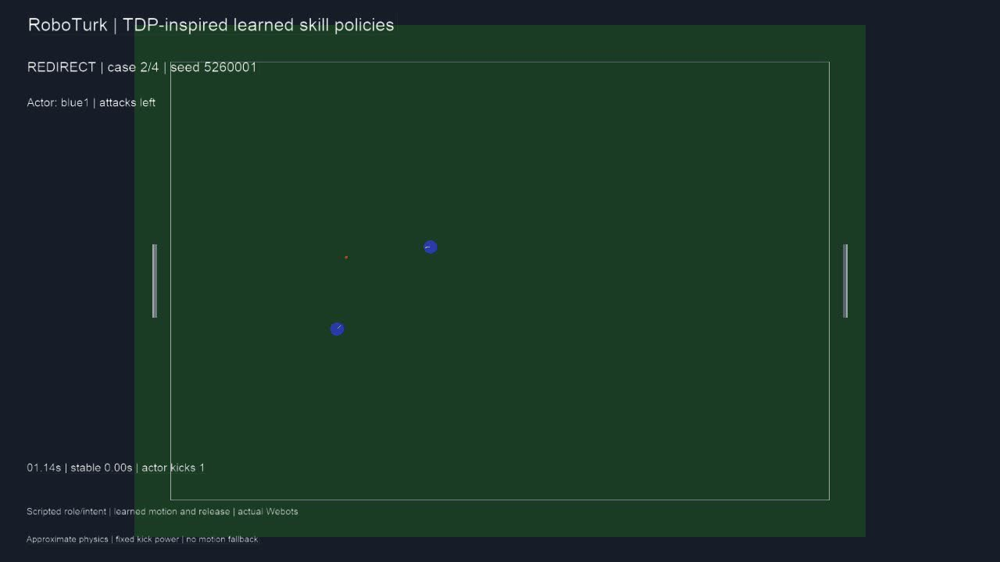

# TDP-inspired ball skill pack — qualified in Webots

Three separately trained neural options passed their predeclared reserved gates:

| Skill | Reserved native cases | Fresh native demo | Mean successful sequence |
| --- | ---: | ---: | ---: |
| Timed receive-and-stop |197/200 (98.5%)|4/4|1.919 s|
| One-touch redirect to goal |200/200|4/4|2.321 s|
| Recover-and-clear to a flank outlet |200/200|4/4|1.729 s|

Across all 600 reserved cases: zero robot collisions, field exits, own goals and
premature clearances. All 242,404 physics samples at 5 ms intervals were independently
audited, together with 60,601 neural calls and coordinator commitment/exit events.
Every case was attempted once. Gates were ≥95% success per skill and zero listed
safety failures. These are separate bounded skill results, not a match win rate.

Receive failures 5050042, 5050170, 5050180 briefly contacted the mouth for 14–15 physics
samples, never established stable possession, and timed out at 8 s. All are retained;
there was no tuning or rerun on reserved seeds. Redirect's longest first-contact
to applied-kick interval was 0.015 s, within the 0.15 s contract. Reception requires 0.5 s
stable stopped possession; clearance requires 0.4 s before release and actual ball
crossing through the assigned flank gate.

[Actual native Webots demo](../../media/tdp-skills-demo.mp4): all 12 fresh cases in
receive→redirect→clear order, 30.8 s, 770 frames, 1280×720 at 25 fps. Every native frame and
original timing is retained, including0.6s outcome holds outside scored episodes.
Approximate section starts: 0 s receive, 10.14 s redirect, 21.50 s clearance.

## Training and selection

Each 128×128 MLP uses 34 observations/four motor-release outputs. Native 200-episode
imitation,100 mixed DAgger episodes and 32,768 anchored PPO steps per skill completed:
98,304 PPO steps total,96 accepted updates, changed actor weights for all three.
BC, DAgger and PPO each passed 60/60 development; no isolated PPO improvement is claimed.
One initialization per skill (711/722/733), not a cross-seed robustness result.
Thirty fresh coordinator development cases per skill also passed before freezing.
The final PPO models were selected before opening any reserved or demo seeds.

The explicit scripted play→role→committed option coordinator selects receive,
redirect or clearance from observable conditions and pass contracts. It checks
reachability and lanes, selects a role, commits until outcome, and cancels for
referee stops, visibility loss or expiry. Motor and release decisions are neural,
without teacher fallback or motion projection. Tactical intents, eligibility,
dribbler enabling and fixed kick power remain scripted. Fixture integration uses
one available non-server receiver; multi-candidate assignment/permutation,
blocked-lane and cancellation behavior are covered by pure contract tests.
The previous qualified learned continuous manager is unchanged. Adding these
options to learned match strategy requires a separate integration/self-play cycle.

## Evidence and reproduction

- [Team-paper study and replay commands](../../docs/TDP_SKILL_PACK.md)
- [Protocol and untouched-at-freeze seed splits](protocol.json)
- [Training audit](training-audit.json),[qualification summary](qualification-summary.json)
- [Receive audit](receive/qualification-audit.json),[redirect audit](redirect/qualification-audit.json),[clearance audit](clear/qualification-audit.json)
- [Movie/event audit](demo-media-audit.json),[freeze](freeze.json),[publication receipt](freeze-publication.json)

Freeze of 432 runtime/model/artifact files was published at
[c21ae5ad](https://github.com/kadiru/metu-ros-pkg/commit/c21ae5ad91ab9b9ff74ad46570ff0abf2ff365b3),
all 435 publication blobs verified remotely before reserved use. Freeze SHA256:
`f060478d12394fe12751dbadb88497652acc4dc12a0871ba8ea5d1d9a52fcb22`.
All stages, demonstration datasets, actual reset/rollout receipts, exact launch
sources and complete development/integration/qualification/demo 5 ms traces remain
under preparation. Large JSON traces use deterministic lossless gzip; transport
manifests bind original and packaged SHA256s. Analytic pilots 20/20 per task are
teachers, explicitly separate from learned results. The full local suite passed
184 tests, with one ROS integration skip; 146 Python files passed formatting.

## Boundaries

Approximate native Webots ground-truth dynamics: ideal body velocity, spring
ball retention and fixed 3.5 m/s velocity kick. Receive/redirect use a stationary
scripted teammate with randomized1.6–2.5 m/s delivery. Redirect goal is unguarded;
clearance uses one static opponent. Colors, IDs, directions, incoming angles,
positions and speeds vary within the published reset distributions. No moving
adversary, unrestricted match, official SSL rule, noisy vision/radio, hardware
or complete live ROS-graph qualification is claimed. The paper-derived behavior
decomposition is our adaptation, not reproduction of the teams' complete methods.
