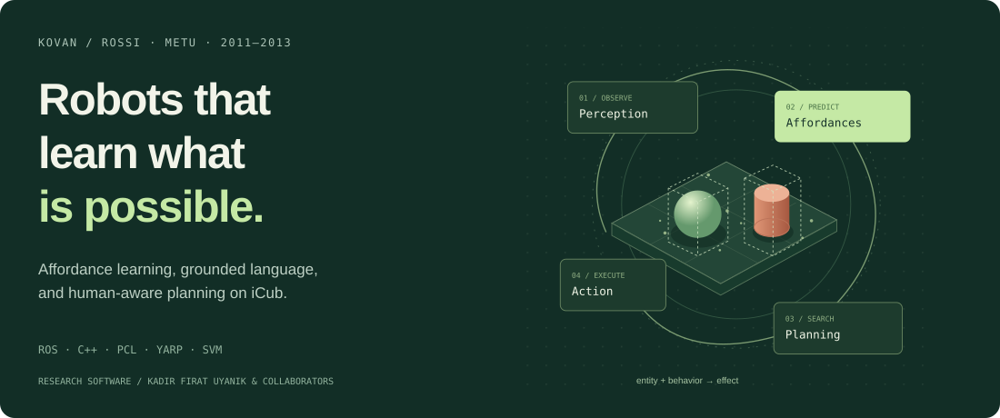
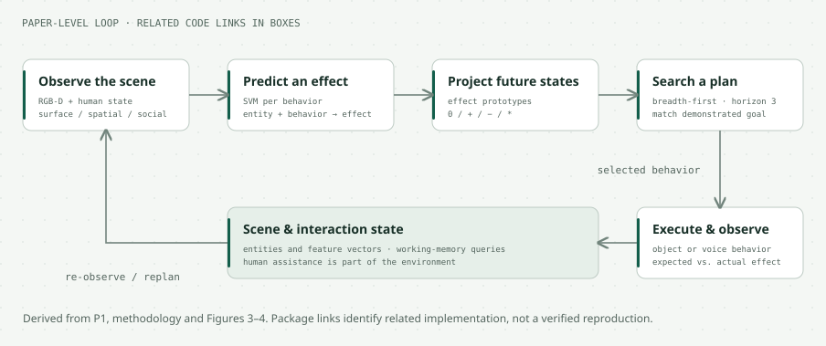
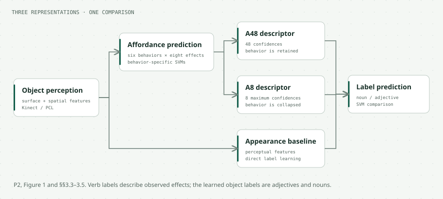

# Affordance Learning ROS Stack

**iCub · perception · grounded language · human-aware planning**  
KOVAN Research Lab / EU FP7 ROSSI, Middle East Technical University · 2011–2013

[Repository overview](../../README.md) · [Robot-soccer stack](../robocup_ssl/README.md) · [Papers](#research-papers) · [Demo](#watch-the-research) · [Code map](#explore-the-code)

## From seeing an object to knowing what to do

An object is more than its appearance: it can be pushed, pulled, grasped, or passed by another person. This research connects **perception, action and observed effects** on the iCub humanoid, using a shared affordance representation:

**entity + behavior → effect**

The stack contains ROS/C++ components for scene perception, working memory, learned effect prediction, robot behavior interfaces, gaze and speech. The associated papers investigate how these capabilities support language grounding and plans that include human assistance. The illustrations below explain those research systems; they are not screenshots of a running installation.

## Social affordances and multi-step planning

In **Learning Social Affordances and Using Them for Planning** [P1], object geometry and human presence, posture and gaze form the perceived state. A behavior-specific SVM predicts an effect; effect prototypes project possible future states. Breadth-first search considers sequences of up to three behaviors, and execution is followed by observation and replanning when the actual effect differs.

**Example:** an object beyond the robot's reach may still be obtainable when a person is present. The robot can select the voice behavior “pass me,” then continue manipulating the object itself. Without the required human assistance, it may determine that the goal cannot be reached.

| Reported study scope [P1] | |
| --- | --- |
| Objects | 35 |
| Object-interaction triplets | 413 |
| Human-interaction triplets | 150 |
| Human participants | 10 |

The motor and voice behaviors are predefined; the learned component predicts their effects. The paper reports three planning scenarios, not a general-purpose autonomy benchmark.

## Grounding adjectives and nouns in action

**Learning Adjectives and Nouns from Affordances on the iCub Humanoid Robot** [P2] compares three representations: **A48**, retaining six behaviors × eight effect confidences; **A8**, retaining the maximum confidence for each effect; and a **direct appearance-based baseline**.

Affordances help with selected adjective distinctions, while appearance is stronger for the four noun categories in this experiment. For example, the reported five-fold cross-validation accuracy for *thin/thick* is 95% with A48 versus 91% with the appearance baseline; noun accuracy is 87.5% versus 94%, respectively. These results are specific to the paper's object set, behaviors and evaluation protocol.

**Towards Context-aware Adjective Learning** [P3] adds the surrounding objects: the same object can be “tall” beside a shorter neighbor and “short” beside a taller one. The paper combines relative perceptual features with affordance information. Its context-aware study is separate from the A48/A8 comparison above.

## Explore the code

| Start here | What to look for |
| --- | --- |
| [`al_perception/CMakeLists.txt`](al_perception/CMakeLists.txt) | Perception target and human, spatial and surface feature-extractor sources |
| [`al_memory/src/Memory.cpp`](al_memory/src/Memory.cpp) | Scene/entity services, working memory and feature-vector publication |
| [`al_prediction/effect_predictor.cpp`](al_prediction/effect_predictor.cpp) | Per-behavior SVM loading, feature scaling, effect queries and behavior-by-effect services |
| [`al_prediction/adjective_predictor.cpp`](al_prediction/adjective_predictor.cpp) | Affordance-based adjective prediction interfaces |
| [`al_prediction/launch/al_prediction.launch`](al_prediction/launch/al_prediction.launch) | Historical effect, shape and adjective node orchestration |
| [`al_behavior/`](al_behavior/) | Robot behavior interfaces |
| [`al_hri_demo/hri_main.cpp`](al_hri_demo/hri_main.cpp) | ROS TF, YARP gaze control, actionlib speech and interaction-state logic |
| [`al_msgs/`](al_msgs/) / [`al_srvs/`](al_srvs/) | Shared message and service definitions |

The code map identifies related implementation. It does not assert that every paper experiment is reproducible from this snapshot or that every package is complete.

## Watch the research

**[Watch the original iCub language-grounding demonstration →](https://www.youtube.com/watch?v=DxLFZseasYA)**  
Archival video link cited in [P2], Section 5. It is the original demonstration, not a newly edited 30–60-second clip.

## Research papers

**[P1] [Learning Social Affordances and Using Them for Planning](https://escholarship.org/uc/item/9cj412wg)**  
Kadir Fırat Uyanık, Yiğit Çalışkan, Asil Kaan Bozcuoğlu, Onur Yürüten, Sinan Kalkan, Erol Şahin. *CogSci*, 2013.

**[P2] [Learning Adjectives and Nouns from Affordances on the iCub Humanoid Robot](https://link.springer.com/chapter/10.1007/978-3-642-33093-3_33)**  
Onur Yürüten, Kadir Fırat Uyanık, Yiğit Çalışkan, Asil Kaan Bozcuoğlu, Erol Şahin, Sinan Kalkan. *From Animals to Animats 12*, 2012, pp. 330–340.

**[P3] [Towards Context-aware Adjective Learning](https://kovan.ceng.metu.edu.tr/~sinan/publications/icra_hri_12.pdf)**  
Kadir Fırat Uyanık, Onur Yürüten, Sinan Kalkan, Erol Şahin. *ICRA Workshop: The Future of HRI*, 2012.

## Archive status and credits

Historical ROS 1 / rosbuild-era research code. Legacy dependencies, launch files and configuration paths need review before attempting a build. No current build or hardware execution has been validated for this documentation update.

The research is collaborative; the author lists above credit the papers, and source files preserve individual and third-party copyright notices. [Source notes and visual attribution](../../docs/RESEARCH_SOURCES.md).
