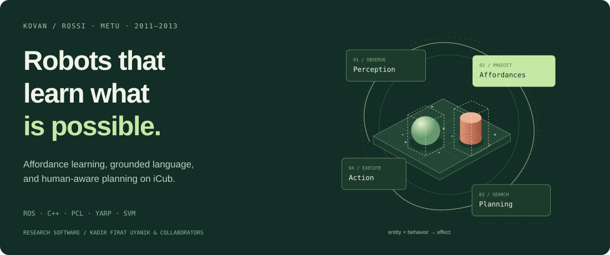
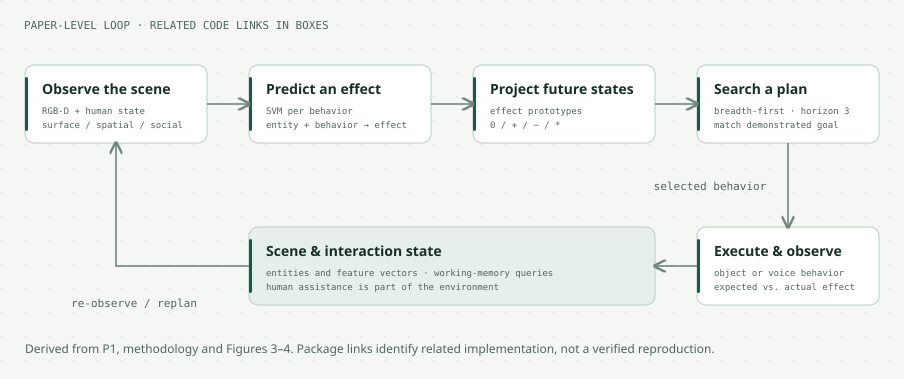
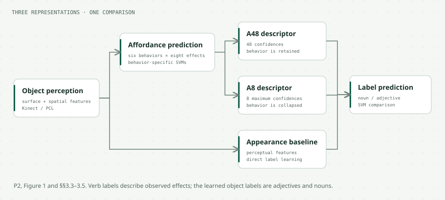
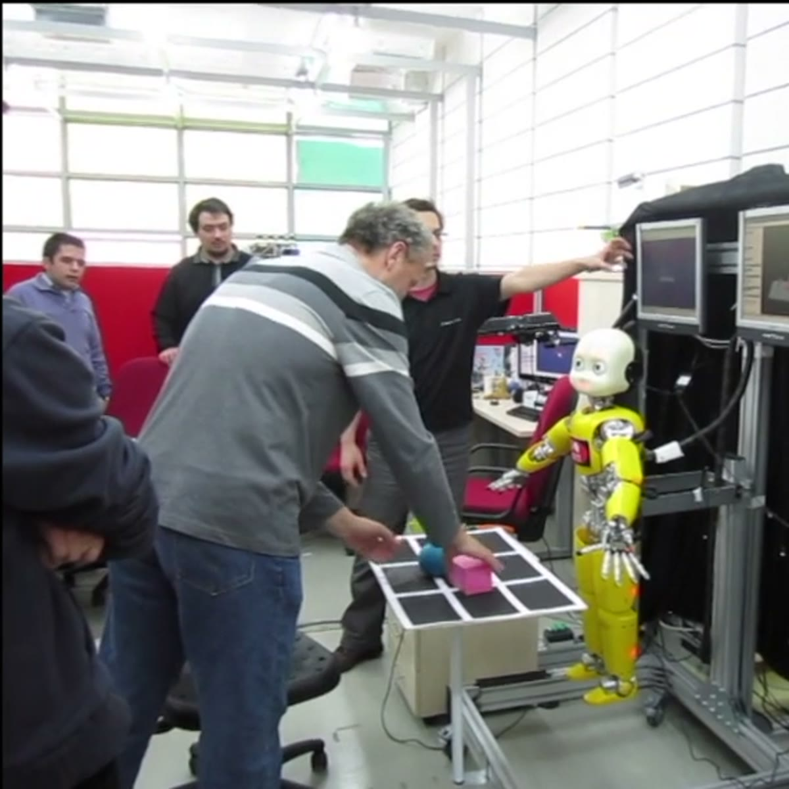

# What can I do with this object?

For a robot, an object is more than a shape. It may be pushable, graspable, or reachable only with someone's help. This iCub research uses **affordances — relationships between an entity, an action and its effect — to connect perception, language and planning**.

KOVAN Research Lab / EU FP7 ROSSI, Middle East Technical University. Historical collaborative research, with the original ROS/C++ implementation preserved here.

*Perception, affordances, planning and action form a loop: observe the world, predict what an action makes possible, act, and observe again.*

## From an action to a plan

**Entity + behavior → predicted effect.** A behavior-specific model predicts what an action will do. A planner can then choose actions, observe their outcome and replan. When an object is out of reach, a person's presence can make “ask them to pass it” a useful action.

*An explanatory research diagram, not a running-system screenshot. [Method and attribution](RESEARCH_GUIDE.md).*

## From actions to language

The same action-based representation helps ground descriptions such as *thin* and *thick*. The language study compares effect-based representations with a direct appearance baseline: what a robot can do with an object provides a different kind of evidence from how the object looks.

Some words also depend on the surrounding objects: the same object can be tall beside one neighbor and short beside another. [Representations, comparisons and context-aware language](RESEARCH_GUIDE.md#grounding-adjectives-and-nouns-in-action).

## See it on iCub

*Archival physical-robot footage. The behaviors are predefined; the learned components predict effects and ground language. [Watch the research film](https://vimeo.com/kadiru/icub-language-grounding) · [Original paper-linked demonstration](https://www.youtube.com/watch?v=DxLFZseasYA).*

## What the papers establish

The social-affordance study used **35 objects, 413 object-interaction triplets, 150 human-interaction triplets and 10 participants**. It reports three planning scenarios, not general-purpose autonomy. The language study found that affordances helped selected adjective distinctions, while appearance performed better on its four noun categories. [Study scopes, comparisons and all three papers](RESEARCH_GUIDE.md#research-papers)

**Kadir's contribution:** ROS/PCL sensing, data collection and learning/planning components across the iCub research. This is collaborative work; the complete paper author lists and source copyright notices preserve individual credit.

## Follow the implementation

| Step | Source |
| --- | --- |
| Perceive entities and features | [Perception targets](al_perception/CMakeLists.txt) |
| Maintain a scene representation | [Working memory](al_memory/src/Memory.cpp) |
| Predict action effects | [Effect predictor](al_prediction/effect_predictor.cpp) |
| Ground adjectives | [Adjective predictor](al_prediction/adjective_predictor.cpp) |
| Connect gaze, speech and interaction | [HRI demonstration](al_hri_demo/hri_main.cpp) |

## Archive status

This is ROS 1 / rosbuild-era code. The source map does not imply every paper experiment can be reproduced from this snapshot. A future reproduction starts by restoring dependencies, data and model artifacts for one named paper experiment, then comparing against its reported protocol.

[Full research guide and citations](RESEARCH_GUIDE.md) · [Source notes](../../docs/RESEARCH_SOURCES.md) · [Repository overview](../../README.md)
