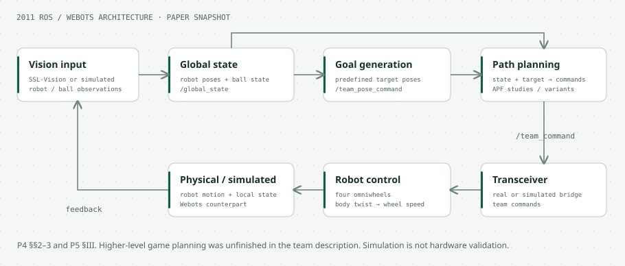

# RoboTurk Robot-Soccer ROS Stack

**RoboCup Small Size League · omnidirectional robots · planning · Webots**  
METU IEEE Student Branch, Robotics and Automation Society · 2009–2011

[Repository overview](../../README.md) · [Affordance-learning stack](../affordance_learning/README.md) · [Code map](#explore-the-code) · [Demos](#watch-the-experiments) · [Research](#papers-and-technical-reports)

## From a global field view to robot motion

RoboTurk connects a team of **five four-omniwheel robots** with global vision, ROS message interfaces, planning and embedded robot control. A Webots counterpart supports simulation experiments before working with the physical system.

The work spans hardware/software integration and path-planning experiments: how to move toward a target around other robots, how potential fields can fail, and how obstacle representations and replanning affect navigation.

## System architecture

Conceptual overview based on the **RoboTurk 2011 Team Description** [P4] and **A study on Artificial Potential Fields** [P5]. The original design separates vision/global state, goal and path planning, command transport, robot control and feedback, with real and simulated counterparts. The team description is a development snapshot, not a claim that all pictured modules were complete.

## Explore the code

| Start here | What to look for |
| --- | --- |
| [`ssl_vision/`](ssl_vision/) | Vision integration resources |
| [`ssl_msgs/`](ssl_msgs/) / [`ssl_srvs/`](ssl_srvs/) | State, command and service interfaces |
| [`ssl_path_planner_/src/SSLPathPlanner.cpp`](ssl_path_planner_/src/SSLPathPlanner.cpp) | Substantive planner: obstacle geometry, collision checks, path reuse, OMPL planning and per-robot execution |
| [`SSLPathPlanner.h`](ssl_path_planner_/include/ssl_path_planner/SSLPathPlanner.h) | Trajectory types, geometry, publishers, subscribers and configured limits |
| [`ssl_game_planner_/`](ssl_game_planner_/) | Historical goal/game-planning package |
| [`ssl_wsim/`](ssl_wsim/) / [`ssl_webots_sim_/`](ssl_webots_sim_/) | Simulation resources |
| [`ssl_teleop_control/`](ssl_teleop_control/) | Teleoperation resources |

**Start with `ssl_path_planner_`, including the trailing underscore.** The similarly named [`ssl_path_planner`](ssl_path_planner/src/main.cpp) is a separate scaffold whose entry point returns immediately. They should not be treated as the same implementation.

The substantive planner builds obstacles from robots, the ball and goals, uses CGAL geometry tests, reuses valid paths and replans when needed. Its initialization selects OMPL **pRRT**, with eight threads, goal bias 0.8 and range 0.08; the planning call uses a **0.100-second solve budget**. These are source-code settings, not measured latency or demonstrated real-time guarantees. See [initialization](ssl_path_planner_/src/SSLPathPlanner.cpp#L1137-L1171) and [planning](ssl_path_planner_/src/SSLPathPlanner.cpp#L651-L750).

## What the planning studies showed

The technical reports [P5–P6] compare additive attractive/repulsive potential fields with navigation functions in three simulation scenarios. The reported execution times and path lengths are:

| Scenario | Additive: time / path | Navigation: time / path |
| --- | --- | --- |
| One obstacle, direct-free path | 2.5 s / 1.25 m | 2.5 s / 1.26 m |
| Three obstacles, indirect-free path | Did not reach goal | 45.52 s / 1.97 m |
| Two obstacles, direct-free path | Did not reach goal | 1.5 s / 1.09 m |

Source: Table I in the reports. These are small historical simulation cases, not a general planner ranking. The work also investigates visibility-aware **obstacle grouping**, representing nearby obstacles as virtual obstacles to address local minima and oscillatory behavior in the tested settings.

The EE586 progress report discusses visibility graphs and RRT variants as further implementation/comparison work. The later source snapshot contains OMPL planning code, but that does not turn the report into a completed APF/VG/RRT benchmark.

## Watch the experiments

**[Obstacle grouping demonstration →](https://www.youtube.com/watch?v=0rp-VhkjYd0)**

| Scenario | Additive potential | Navigation function |
| --- | --- | --- |
| One obstacle | [Watch](https://www.youtube.com/watch?v=ra-4UXbUaz0) | [Watch](https://www.youtube.com/watch?v=QWG0X2xIJ-Y) |
| Three obstacles | [Watch](https://www.youtube.com/watch?v=XreCjhkEJA8) | [Watch](https://www.youtube.com/watch?v=AaW1E8bh9kg) |
| Two obstacles | [Watch](https://www.youtube.com/watch?v=hGoSAFj7SL4) | [Watch](https://www.youtube.com/watch?v=k8oT6fFCZaM) |

Archival video links recovered from [P5], Section VI. These are original experiments, not newly recorded demonstrations; availability is controlled by the video host.

## Papers and technical reports

**[P4] [RoboTurk 2011 Team Description](https://download.tigers-mannheim.de/tdps/2011_TDP_RoboTurk.pdf)**  
Kadir Fırat Uyanık, Mumin Yildirim, Salih Can Camdere, Meric Sariisik, Sertac Olgunsoylu. *RoboCup Small Size League*, 2011. Hardware redesign, ROS architecture and Webots simulation. At the time of writing, several nodes were stubs, physical encoders had not yet been mounted, and higher-level game behaviors remained unfinished.

**[P5] A study on Artificial Potential Fields**  
Kadir Fırat Uyanık. Course technical report. Potential-field experiments, navigation functions and archival demonstration links.

**[P6] A comprehensive study on path planning algorithms in multi-agent robot soccer domain**  
Kadir Fırat Uyanık. *EE586 Artificial Intelligence — Project Progress Report*. Completed preliminary APF tests and a proposed broader comparison.

[P5] and [P6] were reviewed from author-supplied PDFs; no public PDF URL is asserted here. [Detailed source notes](../../docs/RESEARCH_SOURCES.md).

## Archive status and credits

Historical ROS 1 / rosbuild-era sources, with multiple experimental package versions. No current build, hardware run, or performance reproduction has been performed for this documentation update. Preserve the existing per-file licenses and the original authors' credit when reusing code or diagrams.
